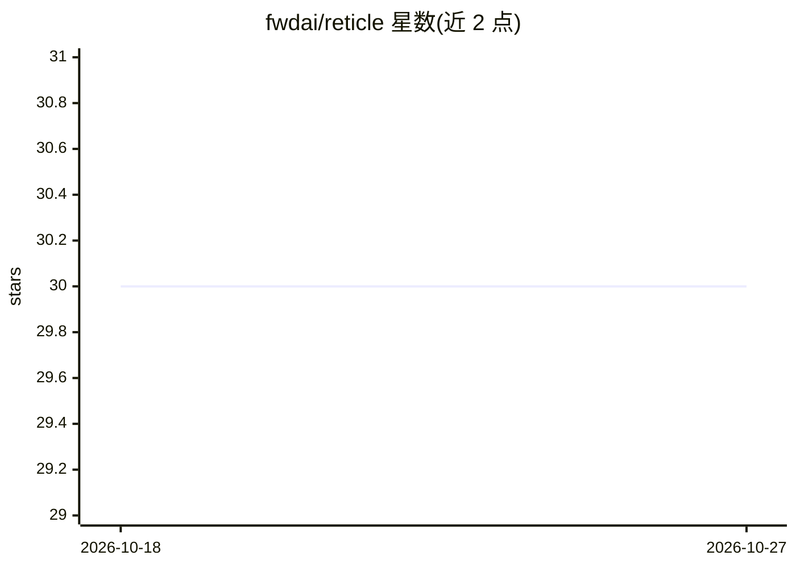

# fwdai/reticle

⭐ 30 · TypeScript · MIT · 推送 2026-08-14 · [GitHub](https://github.com/fwdai/reticle) · [官网](https://reticle.run) · 组织维护

**本地桌面应用：设计、评测与调试 LLM 场景和 AI agent**

面向 LLM 开发者的本地桌面应用（Tauri）：可设计含系统提示、变量、多轮历史、工具调用的场景，同一场景跨 OpenAI、Anthropic、Google 模型运行并对比输出、延迟与成本；支持定义 ReAct 架构 agent 并逐步检查工具调用；内置数据集评测（contains、LLM judge、JSON schema 等断言）、token 成本估算、模板库与本地 SQLite 存储的运行历史。API key 经本地代理注入，不发送到外部服务器。处于公开测试阶段，API 可能变动。

## 筛选速览

| 维度 | 判定 | 备注 |
|---|---|---|
| AI 角色 | `ai-ecosystem` | LLM/agent 周边工具 |
| 许可风险 | `permissive` | MIT |
| 部署形态 | `desktop` | 安装包/桌面程序 |
| 模型依赖 | — | README 未给出锁定关系 |
| 硬件要求 | — | 无带数字的原话,不猜 |
| 安装摩擦 | `low` | 无编译、无系统依赖或容器化 |
| 成熟度 | `idea` | |

## 能力要点

- 同一场景跨 OpenAI/Anthropic/Google 模型运行并对比输出、延迟与成本
- 评测数据集支持 contains/LLM judge/JSON schema 等断言
- 工具可 mock 或以真实 JavaScript 实现执行
- 运行历史与 API key 全部本地存储，经本地代理注入

## 适用场景

- 跨多个模型对比同一提示或 agent 的表现与成本
- 在提示或工具变更后跑数据集评测确认行为未回归
- 逐步调试 agent 的工具调用与中间输出

## 场景标签

`提示工程` `模型评测` · 领域:Agent 开发

## 证据(README 行号)

> L6:  Design, evaluate, and debug LLM scenarios and AI agents across providers — entirely on your machine.
> L40: Reticle lets you build eval datasets directly in the app, paste them in, or import from JSON and CSV. Run your scen

## 星数曲线

2026-10-18 30 → 2026-10-27 30（+0）

---
*卡片 v1 · prompt 1.4 · 生成 2026-10-26 · 置信度 high · 依据 README sha `2674b05043cc` · [字段定义](../../DATASET.md)*
