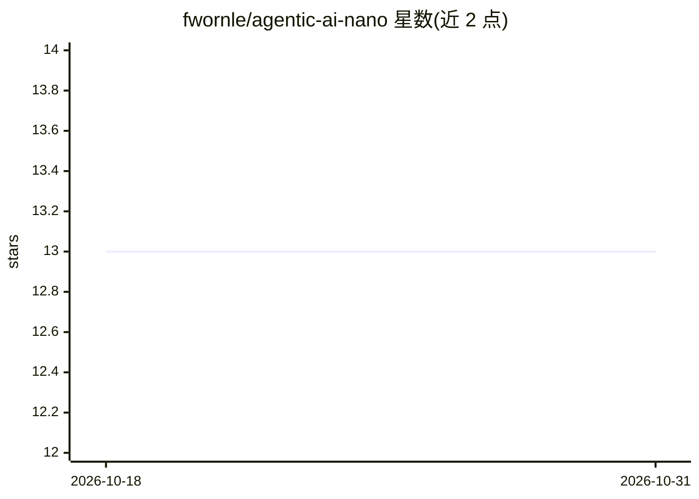

# fwornle/agentic-ai-nano

⭐ 13 · Python · MIT · 推送 2026-10-06 · [GitHub](https://github.com/fwornle/agentic-ai-nano) · 组织维护

**面向 BMW 员工的 6 周 Agentic AI 课程（框架/RAG/协议）**

6 周自学的 Agentic AI 纳米学位课程：3 个模块覆盖 Agent 框架与模式（LangChain/LangGraph/CrewAI/PydanticAI 等）、RAG 系统（分块、向量库、Graph RAG、多模态 RAG）与 MCP/ACP/A2A 通信协议，含生产部署内容。每节课提供 Observer/Participant/Implementer 三档学习路径，完成模块测评与 capstone 可获认证。公开仓库只含通用课程材料，BMW 专属内容通过企业网络检测与 AES-256-GCM 加密按需解密分发，不落入公开仓库；公开用户通过 git clone 与 pip 安装依赖、mkdocs serve 本地查看文档。

## 筛选速览

| 维度 | 判定 | 备注 |
|---|---|---|
| AI 角色 | `ai-knowledge` | 知识聚合/清单类 |
| 许可风险 | `permissive` | MIT |
| 部署形态 | `library` | 以包/库形式分发 |
| 模型依赖 | — | README 未给出锁定关系 |
| 硬件要求 | — | 无带数字的原话,不猜 |
| 安装摩擦 | `low` | 无编译、无系统依赖或容器化 |
| 成熟度 | — | 结构信号不足 |

## 能力要点

- 3 模块×2 周：Agent 框架、RAG、MCP/ACP/A2A 协议
- 每节课三档学习路径（30-180 分钟）
- BMW 企业内容经网络检测 + AES-256-GCM 加密按需分发，公开仓库不含敏感内容
- 本地运行：git clone + venv + mkdocs serve

## 适用场景

- 系统学习 Agent 框架、RAG 与 Agent 通信协议开发
- 按时间预算选择不同深度的学习路径
- BMW 员工在企业网内获取企业专属内容与云端开发环境

## 场景标签

`教程课程` · 领域:学习与行业

## 证据(README 行号)

> L3: **Advanced AI Agent Development & Protocol Integration** - A comprehensive 6-week self-paced program covering modern
> L16: ## Course Structure
> L18: **3 Modules × 2 Weeks Each = 6 Weeks Total**

## 星数曲线

2026-10-18 13 → 2026-10-31 13（+0）

---
*卡片 v1 · prompt 1.4 · 生成 2026-10-31 · 置信度 mid · 依据 README sha `6e27060e6ad1` · [字段定义](../../DATASET.md)*
