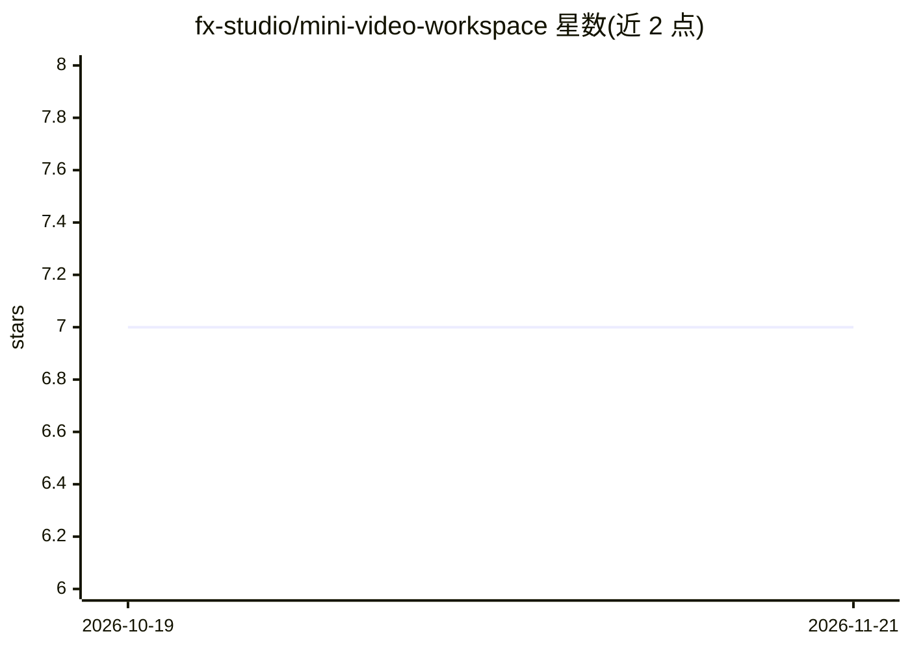

# fx-studio/mini-video-workspace

⭐ 7 · Python · NOASSERTION · 推送 2026-10-12 · [GitHub](https://github.com/fx-studio/mini-video-workspace) · [官网](https://fxstudio.dev) · 个人维护

**用一条命令从 JSON 脚本生成 9:16 越南语配音竖屏视频的本地工作台**

一个竖屏 9:16（1080×1920、30fps）视频生成本地工作台：编写 script.json 后运行 make.py，经 VOICE（edge-tts 逐句生成语音并测量真实时长）、HTML（渲染到模板页面）、RENDER（Playwright 逐帧截图）、MUX（ffmpeg 合成音画）四步输出 mp4。支持三种用法：手动运行命令、通过 skill 让 Claude Code/Antigravity/Codex 类 agent 全流程代做、以及用 PROMPT.md 从空目录让 agent 重建整个工作台。渲染为逐帧截图方式，15 秒视频约需 15–80 秒渲染；许可证为非商业用途。

## 筛选速览

| 维度 | 判定 | 备注 |
|---|---|---|
| AI 角色 | `ai-enhanced` | 去掉 AI 部分产品仍成立 |
| 许可风险 | `none` | NOASSERTION |
| 部署形态 | `library` | 以包/库形式分发 |
| 模型依赖 | — | README 未给出锁定关系 |
| 硬件要求 | — | 无带数字的原话,不猜 |
| 安装摩擦 | `medium` | 含编译或系统依赖之一 |
| 成熟度 | — | 结构信号不足 |

## 能力要点

- script.json 一条命令输出带越南语配音与同步字幕的 mp4
- edge-tts 生成语音，timing-manifest 按真实语音时长驱动画面切换
- 附带 tao-video skill 与 PROMPT.md，agent 可代做或从空目录重建工作台
- --check-seek 对帧渲染做逐字节一致性校验

## 适用场景

- 批量制作 TikTok/Reels 风格的竖屏短视频
- 让 coding agent 从一句需求自动完成脚本到 mp4 产出
- 学习 HTML 逐帧渲染合成视频的流水线实现

## 场景标签

`视频生成` `语音合成` · 领域:内容生成

## 证据(README 行号)

> L46: 1. **VOICE:** mỗi câu một file giọng bằng edge-tts, đo độ dài thật, ghi `timing-manifest.json` (câu nào bắt đầu và 
> L49: 3. **RENDER:** Playwright mở trang, gọi `seek(t)` cho từng khung (30 khung một giây), chụp lại, đẩy thẳng vào ffmpe
> L84: Mở repo trong Claude Code (đọc `.claude/skills/`) hoặc Antigravity / Codex (đọc `.agents/skills/`), rồi nói:

## 星数曲线

2026-10-19 7 → 2026-11-21 7（+0）

---
*卡片 v1 · prompt 1.4 · 生成 2026-11-20 · 置信度 high · 依据 README sha `e1fba0225969` · [字段定义](../../DATASET.md)*
