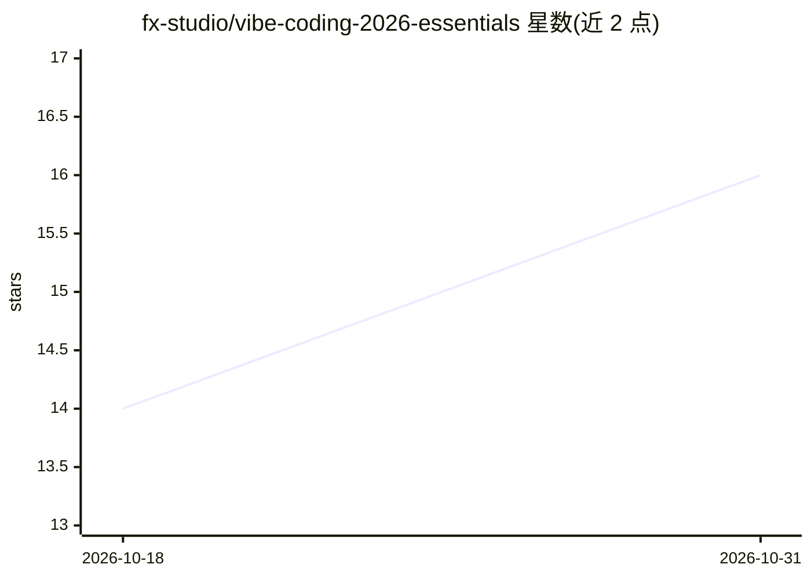

# fx-studio/vibe-coding-2026-essentials

⭐ 16 · NOASSERTION · 推送 2026-07-31 · [GitHub](https://github.com/fx-studio/vibe-coding-2026-essentials) · [官网](https://fxstudio.dev) · 个人维护

**面向不写代码 IT 人群的越南语 vibe coding 免费电子书**

由 Tien Le (fxstudio.dev) 以个人名义编写的越南语免费技术书，20 章、7 部分、3 个附录、54 幅插图，共 308 页。面向 Tester/QA、PM、BA 等不日常写代码的 IT 从业者，讲解 5 阶段流程、prompting、PRD 与 rules file 编写、读懂 AI 生成代码（HTML/CSS/JavaScript）、测试调试与安全审查、LLM 与 agentic workflow/MCP 概念。明确不包含具体工具操作步骤与价格对比；提供 PDF/EPUB（Releases 下载）及 GitHub markdown 阅读方式。内容 CC BY-NC-ND 4.0，templates/ 代码为 MIT。

## 筛选速览

| 维度 | 判定 | 备注 |
|---|---|---|
| AI 角色 | `ai-knowledge` | 知识聚合/清单类 |
| 许可风险 | `none` | NOASSERTION |
| 部署形态 | `None` |  |
| 模型依赖 | — | README 未给出锁定关系 |
| 硬件要求 | — | 无带数字的原话,不猜 |
| 安装摩擦 | `low` | 无编译、无系统依赖或容器化 |
| 成熟度 | — | 结构信号不足 |

## 能力要点

- 20 章 7 部分覆盖流程、prompting、PRD、代码理解、测试与安全
- 附 30 个示例 prompt、安全检查清单与英越术语表
- 提供 PDF/EPUB 与 GitHub markdown 多种阅读格式
- templates/ 内含可直接使用的 PRD 与 rules file 模板

## 适用场景

- 作为 Tester/PM/BA 学习指导和评估 AI 编码工作
- 按 5 阶段流程为 AI 编写 PRD 与 prompt
- 学习审查 AI 生成代码的测试与安全方法

## 场景标签

`教程课程` · 领域:学习与行业

## 证据(README 行号)

> L11: Sách miễn phí, tiếng Việt, dành cho người làm trong ngành IT nhưng **không viết code hàng ngày** — Tester/QA, Proje
> L3: **Tư duy, quy trình và kỹ thuật cho Tester, PM, BA — người làm IT không viết code**

## 星数曲线

2026-10-18 14 → 2026-10-31 16（+2）

---
*卡片 v1 · prompt 1.4 · 生成 2026-10-30 · 置信度 high · 依据 README sha `058cab0692d0` · [字段定义](../../DATASET.md)*
