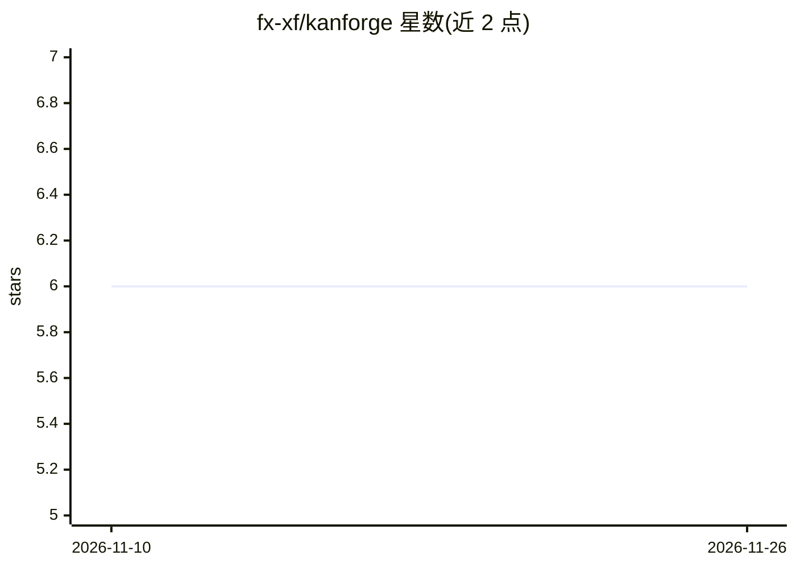

# fx-xf/kanforge

⭐ 6 · Python · Apache-2.0 · 推送 2026-11-08 · [GitHub](https://github.com/fx-xf/kanforge) · [官网](https://fx-xf.github.io/kanforge/) · 个人维护

**多后端 KAN 库：PyTorch/MLX/JAX 上构建与部署 Kolmogorov–Arnold 网络**

实现 Kolmogorov–Arnold Network 层的 Python 库，将神经网络权重替换为可学习的小函数，提供 26 类基函数（B-spline、Chebyshev、Fourier 等），统一参数布局运行于 PyTorch（CUDA/ROCm/MPS/CPU）、Apple MLX 与 JAX/Flax 三种后端，核心仅依赖 NumPy。附带融合 GPU 内核、任意阶导数、符号公式解释（sympy）、MLP 转 KAN、KAN 卷积与 transformer 改造，以及 ONNX、Core ML、FPGA 导出。Apache-2.0 许可。

## 筛选速览

| 维度 | 判定 | 备注 |
|---|---|---|
| AI 角色 | `ai-native` | 本体是模型或模型工具 |
| 许可风险 | `permissive` | Apache-2.0 |
| 部署形态 | `library` | 以包/库形式分发 |
| 模型依赖 | — | README 未给出锁定关系 |
| 硬件要求 | — | 无带数字的原话,不猜 |
| 安装摩擦 | `medium` | 含编译或系统依赖之一 |
| 成熟度 | — | 结构信号不足 |

## 能力要点

- 26 类基函数，三种后端统一参数布局与融合 GPU 内核
- 训练后曲线转符号公式（sympy 解释）
- ONNX / Core ML / FPGA 导出
- MLP 转 KAN、KAN 卷积、PINN 导数支持

## 适用场景

- 在物理定律、符号公式、科学表格数据上做回归与公式发现
- 训练物理信息神经网络（PINN）与算子学习模型
- 将训练好的 KAN 导出为 ONNX/Core ML 或部署到 FPGA

## 场景标签

 · 领域:机器学习/科学计算

## 证据(README 行号)

> L16: A Kolmogorov–Arnold Network replaces every weight of a neural network with a
> L18: 26 families of edge functions, on PyTorch, Apple MLX and JAX — one parameter
> L32: `coreml`. The core depends on NumPy only.

## 星数曲线

2026-11-10 6 → 2026-11-26 6（+0）

---
*卡片 v1 · prompt 1.4 · 生成 2026-11-20 · 置信度 high · 依据 README sha `2b969ed6189a` · [字段定义](../../DATASET.md)*
