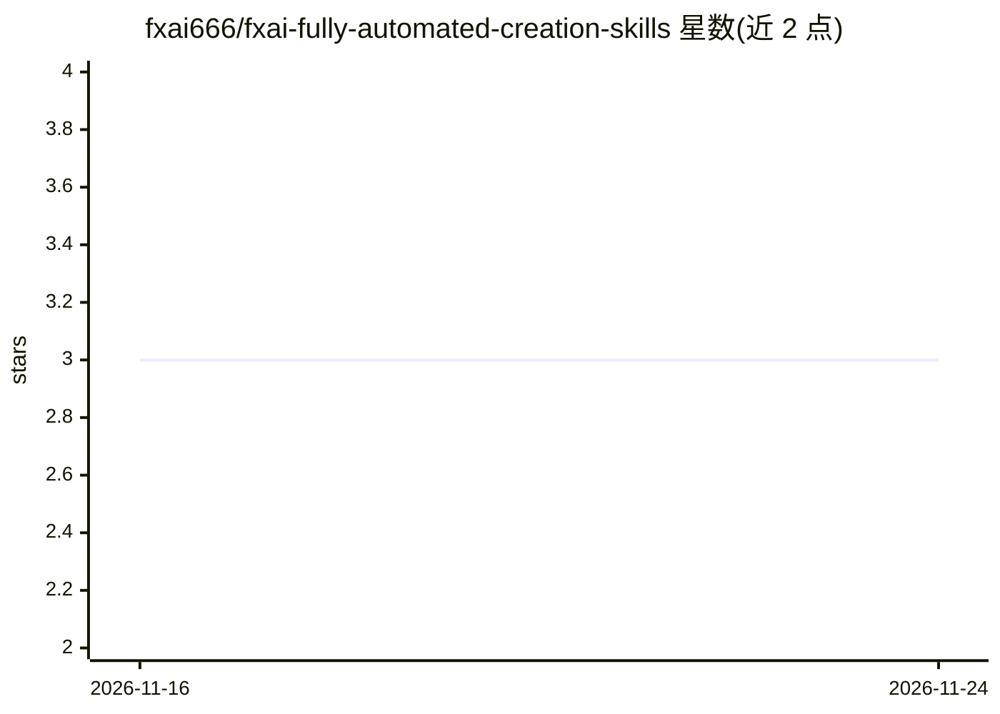

# fxai666/fxai-fully-automated-creation-skills

⭐ 3 · Python · 推送 2026-11-18 · [GitHub](https://github.com/fxai666/fxai-fully-automated-creation-skills) · [官网](https://www.fxai.site) · 个人维护 · 中文 README

**装进智能体的全自动化视频创作技能包：一句话从剧本到发布**

按 SKILL.md 通用技能规范组织的 44 个技能，装入任意能读技能目录、执行本机命令、读写文件的智能体后，由智能体编排短剧、MV、数字人口播、广告片、海报、换脸换人、配音字幕等生产链路。算力依托云端 GPU 镜像（ComfyUI+自研节点+模型）或本地整合包，重型任务自动开关机，产物附交付清单。纯 CPU 部分可独立运行；商用需向作者赞助获取使用授权。

## 筛选速览

| 维度 | 判定 | 备注 |
|---|---|---|
| AI 角色 | `ai-native` | 本体是模型或模型工具 |
| 许可风险 | `none` | — |
| 部署形态 | `None` |  |
| 模型依赖 | — | README 未给出锁定关系 |
| 硬件要求 | `gpu-24g` | |
| 安装摩擦 | `medium` | 含编译或系统依赖之一 |
| 成熟度 | — | 结构信号不足 |

## 能力要点

- 44 个技能覆盖 7 条主管线（MV/短剧/广告/数字人等）与图像、声音、发布环节
- 通用 SKILL.md 规范，不绑定特定智能体平台
- 支持仙宫云 GPU 镜像一键部署与本地整合包两种算力方式
- 每条链路带判据、失败处置与交付验收口径，交付视频含 AIGC 隐式标识

## 适用场景

- 做号的内容团队批量生产短剧、MV、口播视频
- 电商与品牌岗快速出广告片与封面海报
- 工作室在自己的机器或云实例上跑换脸换人，素材不外传
- 一条命令把成片自动发布到抖音、小红书、公众号

## 场景标签

`工作流自动化` `图像生成` `视频生成` · 领域:效率与自动化

## 证据(README 行号)

> L11: 把一整套内容生产流水线装进你的智能体。你不用记命令、不用拼参数、不用打开 ComfyUI 拖节点——说一句「做一条 30 秒的仙侠 MV」「把这段口播做成数字人视频」「这条片换个人」，智能体自己判断该调用哪条链路、该等多久、产物落
> L19: 这套技能按**通用技能规范**组织，不是某个产品的插件：一个技能 = 一个目录 + `SKILL.md`（触发描述 + 铁律 + 命令速查）+ 按需加载的 `references/`。**任何能读技能目录、能执行本机命令、能读写文
> L46: |**仙宫云镜像**|云端 GPU 实例|ComfyUI 本体 + 凤希自研节点 + 全套模型（生图 / 出视频 / 超分 / 换脸换人 / 人声分离）|

## 星数曲线

2026-11-16 3 → 2026-11-24 3（+0）

---
*卡片 v1 · prompt 1.4 · 生成 2026-11-22 · 置信度 high · 依据 README sha `d726c09bb427` · [字段定义](../../DATASET.md)*
