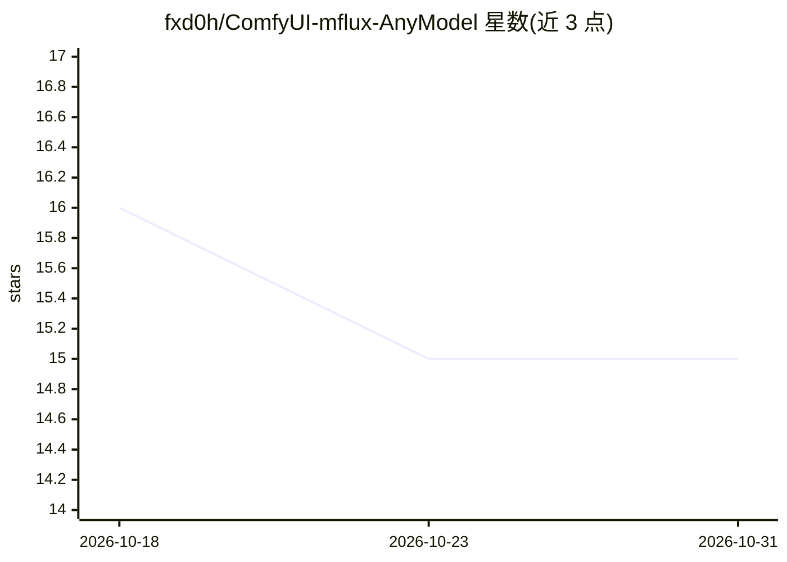

# fxd0h/ComfyUI-mflux-AnyModel

⭐ 15 · Python · MIT · 推送 2026-10-16 · [GitHub](https://github.com/fxd0h/ComfyUI-mflux-AnyModel) · 个人维护

**在 ComfyUI 中于 Apple Silicon 上运行 mflux/MLX 图像模型的节点集**

面向 ComfyUI 的自定义节点包，在 Apple Silicon（MLX/Metal）上通过统一 loader 与 sampler 驱动 FLUX.1、FLUX.2 Klein、Qwen-Image、Krea 2、Ideogram 4、ERNIE-Image 等 mflux 模型族及图像条件变体。核心机制是能力注册表：按模型 introspect generate_image 签名，只转发其接受的参数，无效参数被丢弃并备注。附带 DepthPro 深度图、FIBO-vlm（Qwen3-VL）提示词生成、ADE20K 自动分割掩码、SeedVR2 放大等节点，13 个可打开示例工作流。限制：仅 MLX/Metal，无 CUDA 路径；需 ComfyUI 与 mflux>=0.18.0。

## 筛选速览

| 维度 | 判定 | 备注 |
|---|---|---|
| AI 角色 | `ai-ecosystem` | LLM/agent 周边工具 |
| 许可风险 | `permissive` | MIT |
| 部署形态 | `library` | 以包/库形式分发 |
| 模型依赖 | — | README 未给出锁定关系 |
| 硬件要求 | — | 无带数字的原话,不猜 |
| 安装摩擦 | `medium` | 含编译或系统依赖之一 |
| 成熟度 | — | 结构信号不足 |

## 能力要点

- 单一 loader+sampler 驱动多族 mflux 模型（文生图/编辑/深度/ControlNet/Redux）
- 能力注册表按模型签名只转发有效参数，无效参数丢弃并备注
- 图像随去噪流入节点、进度条推进、可中途取消
- 附带 VLM 提示词生成（FIBO-vlm）、DepthPro 深度图、ADE20K 自动掩码、SeedVR2 放大节点

## 适用场景

- 在 Mac 上用 ComfyUI 串联本地图像生成与编辑工作流
- 室内设计/翻新：锁定房间几何做重风格化或指定区域重绘
- 按参考图做风格迁移（Redux mood board）
- 用本地 VLM 从照片或简述自动生成提示词

## 场景标签

`图像生成` · 领域:内容生成

## 证据(README 行号)

> L3: Run any mflux model inside ComfyUI on Apple
> L10: The node is built around a **capability registry**: for the selected model it
> L37: - Apple Silicon (M1–M5). MLX and Metal only; there is no CUDA path.

## 星数曲线

2026-10-18 16 → 2026-10-31 15（-1）

---
*卡片 v1 · prompt 1.4 · 生成 2026-10-31 · 置信度 mid · 依据 README sha `a55a252cb787` · [字段定义](../../DATASET.md)*
