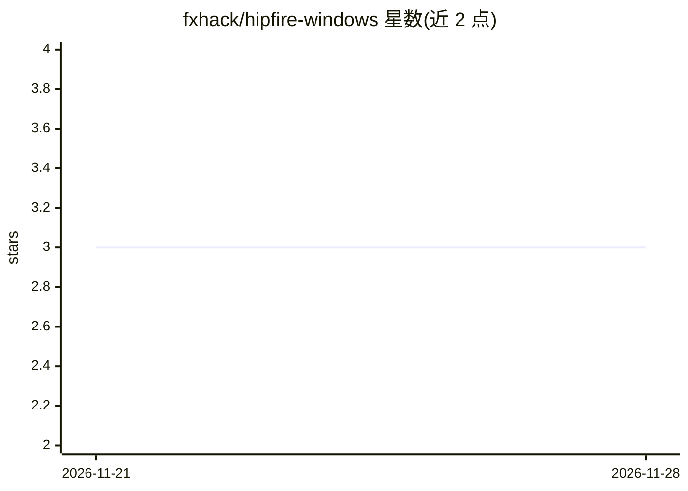

# fxhack/hipfire-windows

⭐ 3 · Python · NOASSERTION · 推送 2026-10-24 · [GitHub](https://github.com/fxhack/hipfire-windows) · 个人维护 · 中文 README

**让 hipfire 推理引擎在 AMD Strix Halo Windows 上原生运行的补丁集**

hipfire 是专为 AMD GPU 优化的 Rust 原生 LLM 推理引擎，默认仅支持 Linux；本项目通过两个补丁使其在 Windows 11 上原生运行：其一以环境变量解除 Windows 上 VMM KV 后端的拒绝，解锁 256K 上下文；其二修复 UMA APU 上依赖 /proc/meminfo 的 Linux 专属内存估算路径。面向拥有 Strix Halo（gfx1151/Radeon 8060S）硬件、要在 Windows 本地运行 Qwen3.8-27B 的用户。提供预编译二进制与源码编译两条路径，配套 .bat 脚本、Web UI 与 OpenAI 兼容 API。限制：仅适用特定硬件，多 slot 并发、FP8 WMMA 等功能在 gfx1151 上不可用。

## 筛选速览

| 维度 | 判定 | 备注 |
|---|---|---|
| AI 角色 | `ai-ecosystem` | LLM/agent 周边工具 |
| 许可风险 | `none` | NOASSERTION |
| 部署形态 | `desktop` | 安装包/桌面程序 |
| 模型依赖 | — | README 未给出锁定关系 |
| 硬件要求 | — | 无带数字的原话,不猜 |
| 安装摩擦 | `medium` | 含编译或系统依赖之一 |
| 成熟度 | — | 结构信号不足 |

## 能力要点

- 两个补丁（VMM KV 解锁 + UMA 内存信息修复）使 hipfire 在 Windows 原生运行
- 支持 Qwen3.8-27B 256K 上下文与 DFlash 推测解码，附基准数据 JSON
- 提供 Releases 预编译二进制下载与 cargo 源码编译两种获取方式
- 服务兼容 OpenAI API 格式，带端口 11435 的 Web 聊天界面

## 适用场景

- 在 Strix Halo 设备的 Windows 11 上本地运行 Qwen3.8-27B
- 需要 256K 长上下文与 DFlash 推测解码的本地推理
- 通过 OpenAI 兼容 API 把本地模型接入应用
- 复现或核对 benchmarks 目录下的基准测试数据

## 场景标签

`推理引擎` · 领域:训练与推理

## 证据(README 行号)

> L20: hipfire 是专为 AMD GPU 优化的 Rust 原生 LLM 推理引擎，默认仅支持 Linux。本项目通过 **两个补丁** 让它在 Windows 上原生运行：
> L28: - AMD Ryzen AI Max+ 395（Strix Halo）配 Radeon 8060S（gfx1151）

## 星数曲线

2026-11-21 3 → 2026-11-28 3（+0）

---
*卡片 v1 · prompt 1.4 · 生成 2026-11-22 · 置信度 high · 依据 README sha `2f1290147c73` · [字段定义](../../DATASET.md)*
