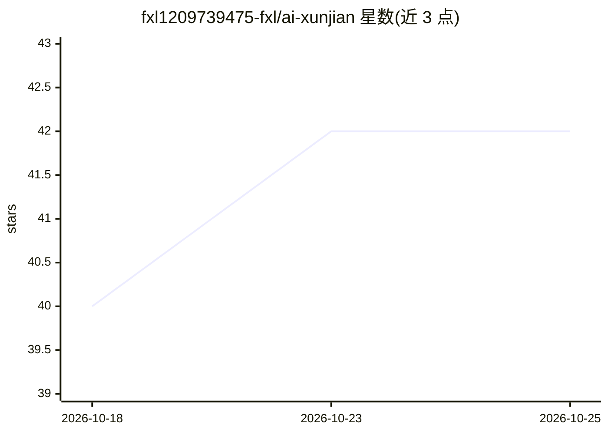

# fxl1209739475-fxl/ai-xunjian

⭐ 42 · TypeScript · MIT · 推送 2026-08-07 · [GitHub](https://github.com/fxl1209739475-fxl/ai-xunjian) · 个人维护 · 中文 README

**AI 口播短视频初剪系统：自动剪气口转写上动效，编辑器定剪**

面向口播短视频创作者的开源剪辑系统，分两个模块：初剪引擎（firstcut/）一条命令完成旋转元数据探测、静音剪气口、重说句检测剪除、提速、响度归一、faster-whisper 词级转写字幕，并调用用户自己的 LLM CLI 按语义生成章节/弹字/动效卡片的 timeline.json；AI 视频编辑器提供五轨时间轴、28 种动效组件、实时预览与三档导出（HyperFrames 无头渲染）。视频完全本地处理，AI 能力经 LLM CLI 接入；Windows 原生无头导出为实验性，建议 WSL2。未装 uv/LLM CLI 时可降级为机械预处理。

## 筛选速览

| 维度 | 判定 | 备注 |
|---|---|---|
| AI 角色 | `ai-native` | 本体是模型或模型工具 |
| 许可风险 | `permissive` | MIT |
| 部署形态 | `library` | 以包/库形式分发 |
| 模型依赖 | — | README 未给出锁定关系 |
| 硬件要求 | — | 无带数字的原话,不猜 |
| 安装摩擦 | `medium` | 含编译或系统依赖之一 |
| 成熟度 | `idea` | |

## 能力要点

- 静音剪气口与重复句检测（重说自动剪除，剪除清单可核对）
- faster-whisper 词级时间戳转写，≤14 字/行逐字字幕
- AI 初剪结果落在 timeline.json，编辑器五轨时间轴可视化修改、改动一秒内生效
- 完全本地处理，AI 能力通过用户自备的 LLM CLI 接入，可优雅降级

## 适用场景

- 口播视频作者把原片丢进去自动出初剪再手动定剪
- 对 AI 剪辑结果逐项修改（改文案、挪动效时间、补组件）
- 用开放数据 timeline.json 做脚本批量处理与版本管理

## 场景标签

`语音识别` `图像视频处理` · 领域:感知与多模态

## 证据(README 行号)

> L30: |**转写字幕**|faster-whisper 词级时间戳，自动切成 ≤14 字/行的逐字字幕|
> L31: |**AI 初剪**|AI 通读字幕，按语义自动上章节、弹字、动效卡片（调用你自己的 LLM CLI）|

## 星数曲线

2026-10-18 40 → 2026-10-25 42（+2）

---
*卡片 v1 · prompt 1.4 · 生成 2026-10-25 · 置信度 high · 依据 README sha `4290df75325a` · [字段定义](../../DATASET.md)*
