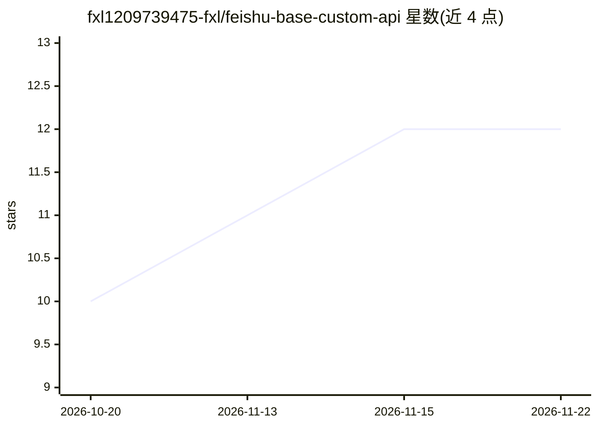

# fxl1209739475-fxl/feishu-base-custom-api

⭐ 12 · HTML · MIT · 推送 2026-09-07 · [GitHub](https://github.com/fxl1209739475-fxl/feishu-base-custom-api) · [官网](https://fxl1209739475-fxl.github.io/feishu-base-custom-api/) · 个人维护 · 中文 README

**飞书多维表格插件：批量调用自选大模型 API 生成文本/图片/视频写回表格**

以单个 index.html 形式实现的飞书多维表格自定义插件，支持填入任意 OpenAI 兼容 API 地址、Key 与模型名，对表格行批量执行文本、图片、视频生成任务并通过【列名】模板引用各行列内容，结果写回文本列或附件列。提供并发、超时、重试与已填行跳过/覆盖控制；配置仅存本机浏览器。视频任务因异步与跨域限制需自建代理或经中转站调用。作者自述源自电商运营的批量文案与主图工作流。

## 筛选速览

| 维度 | 判定 | 备注 |
|---|---|---|
| AI 角色 | `ai-native` | 本体是模型或模型工具 |
| 许可风险 | `permissive` | MIT |
| 部署形态 | `None` |  |
| 模型依赖 | — | README 未给出锁定关系 |
| 硬件要求 | — | 无带数字的原话,不猜 |
| 安装摩擦 | `low` | 无编译、无系统依赖或容器化 |
| 成熟度 | — | 结构信号不足 |

## 能力要点

- 任意 OpenAI 兼容接口可自填 API 地址、Key、模型名
- 【列名】模板自动替换行内真实内容进行批量生成
- 文本写文本列、图片/视频写附件列，含图生图与文生视频/首帧/多图参考
- 任务ID列落表与续查未完成视频任务，避免重复扣费

## 适用场景

- 电商表格里为几百行产品信息批量生成文案与主图
- 接自己的中转站或指定模型替代表格自带 AI
- 批量生成短视频素材并写回表格附件列

## 场景标签

`AI 写作` `视频生成` `图像生成` · 领域:内容生成

## 证据(README 行号)

> L3: **让飞书多维表格直连任意大模型 API——文本批量生成 + 图片批量生成 + 视频批量生成，一个插件全搞定。**
> L13: 飞书多维表格自带的 AI 能力**没法接你自己的 API**：不能换中转站、不能指定模型、不能调用生图接口。做电商的经常需要"表格里 500 行产品信息，每行生成一条文案 / 一张主图"——这个插件就是干这个的：
> L15: - 🔗 **任意 OpenAI 兼容接口**：API 地址、Key、模型名全都你自己填（支持各类中转站）

## 星数曲线

2026-10-20 10 → 2026-11-22 12（+2）

---
*卡片 v1 · prompt 1.4 · 生成 2026-11-18 · 置信度 high · 依据 README sha `842a9b408b03` · [字段定义](../../DATASET.md)*
