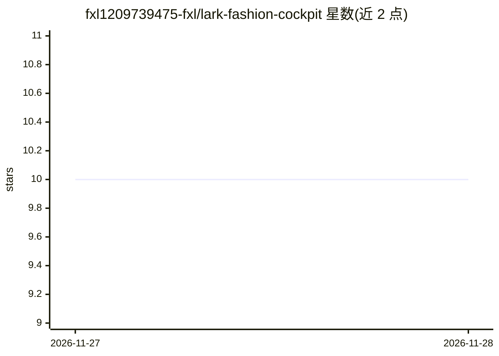

# fxl1209739475-fxl/lark-fashion-cockpit

⭐ 10 · Python · MIT · 推送 2026-05-21 · [GitHub](https://github.com/fxl1209739475-fxl/lark-fashion-cockpit) · 个人维护 · 中文 README

**女装电商企业的智能驾驶舱：聊天即可用 33 个飞书 CLI 业务 skill**

基于飞书 CLI 构建的电商运营驾驶舱，由 33 个 self-contained sub-skill 组成，覆盖经营数据（产品库、补货、利润、上新预测、用户画像）、跨平台 IM（飞书/企微/个人微信消息收发）、内容营销（博主监控、竞品监控、直播复盘）、任务协作（任务生命周期、OKR、早报、会议分发）与基础设施（自然语言路由、调度器、知识库）。本地 Web 驾驶舱（FastAPI 8080）+ 聊天浮窗做统一入口，员工用自然语言即可触发各 skill。每个 skill 可通过 npx skills add 单独安装。

## 筛选速览

| 维度 | 判定 | 备注 |
|---|---|---|
| AI 角色 | `ai-enhanced` | 去掉 AI 部分产品仍成立 |
| 许可风险 | `permissive` | MIT |
| 部署形态 | `library` | 以包/库形式分发 |
| 模型依赖 | — | README 未给出锁定关系 |
| 硬件要求 | — | 无带数字的原话,不猜 |
| 安装摩擦 | `low` | 无编译、无系统依赖或容器化 |
| 成熟度 | — | 结构信号不足 |

## 能力要点

- 33 个 self-contained sub-skill，npx skills add 单独安装
- DEEPSEEK 自然语言路由把模糊指令分类到七类后路由到对应 skill
- 跨平台 IM 汇集：飞书/企业微信/个人微信一处收发
- 老板分身：200-300 题语料+历史决策案例训练的问答分身

## 适用场景

- 服装电商老板用浏览器聊天查看销售、库存与利润数据
- 每日自动生成补货建议与跨渠道情报早报
- 直播下播后自动生成话术复盘报告
- 多平台客户消息汇集与自动化打标分群

## 场景标签

`聊天机器人` `数据分析` `工作流自动化` `知识库管理` · 领域:效率与自动化

## 证据(README 行号)

> L3: > **一句话定位：** 给电商企业做**提效降耗的智能驾驶舱**——加速信息流转、让数据透明精准、把重复任务自动化、给老板智能决策辅助。33 个垂直业务 skill 串成一个"全员可用的本地系统"，任何员工跟它聊天就能用全部能力。
> L48: |🚀 **入口层**|本地驾驶舱网页 + 常驻 AI 聊天浮窗|3|
> L69: - **解决**：本地 Web 驾驶舱（FastAPI 8080）+ 常驻聊天浮窗 + DEEPSEEK 自然语言路由，把所有 skill 包装成"任何人打开浏览器跟系统说话就能用"

## 星数曲线

2026-11-27 10 → 2026-11-28 10（+0）

---
*卡片 v1 · prompt 1.4 · 生成 2026-11-27 · 置信度 mid · 依据 README sha `7cf082d8d9e6` · [字段定义](../../DATASET.md)*
