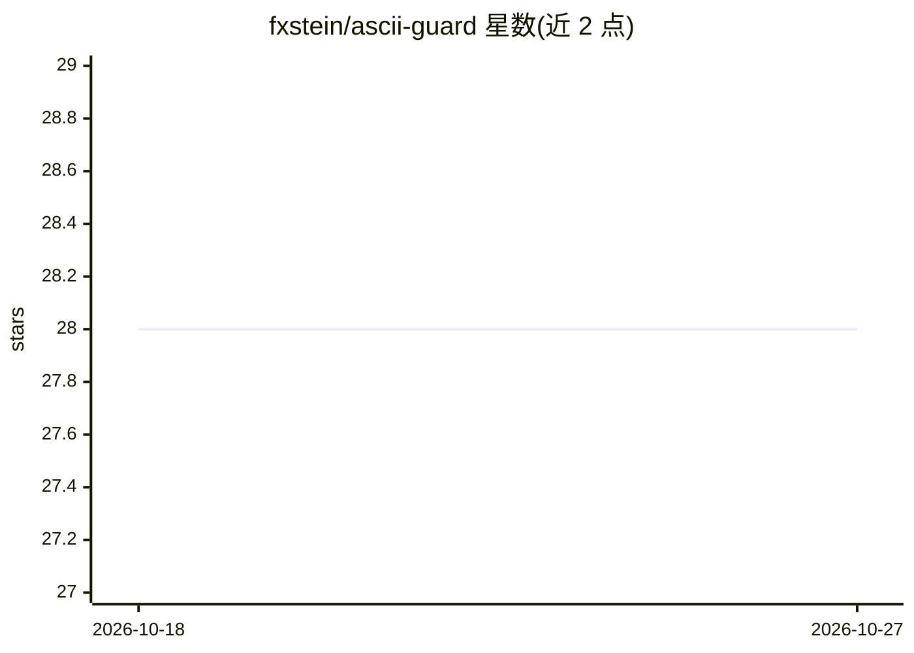

# fxstein/ascii-guard

⭐ 28 · Python · Apache-2.0 · 推送 2026-10-25 · [GitHub](https://github.com/fxstein/ascii-guard) · 个人维护

**检测并修复文档中 AI ASCII 框图错位的 Python linter**

面向维护文档的开发者的零依赖 Python linter：检测 ASCII 框图（流程图、嵌套结构）中边框错位、角字符不匹配、宽度不一致等问题，并提供自动修复命令（含 --dry-run 预览）。支持 Unicode 制表符（单线/粗线/双线），可用 HTML 注释形式的忽略标记跳过故意错位的示例。Python 3.11+ 纯标准库实现，3.10 仅需 tomli 一个依赖；提供 lint_file/fix_file/detect_boxes 等稳定 Python API 供文档流水线与 CI/CD 集成。Apache 2.0 许可。

## 筛选速览

| 维度 | 判定 | 备注 |
|---|---|---|
| AI 角色 | `ai-ecosystem` | LLM/agent 周边工具 |
| 许可风险 | `permissive` | Apache-2.0 |
| 部署形态 | `library` | 以包/库形式分发 |
| 模型依赖 | — | README 未给出锁定关系 |
| 硬件要求 | — | 无带数字的原话,不猜 |
| 安装摩擦 | `low` | 无编译、无系统依赖或容器化 |
| 成熟度 | — | 结构信号不足 |

## 能力要点

- 检测并自动修复 ASCII 框图的垂直/水平对齐、角字符与宽度问题
- Python 3.11+ 零依赖纯标准库，3.10 仅需 tomli
- 支持单线/粗线/双线 Unicode 制表字符
- 提供稳定 Python API（lint_file/fix_file/detect_boxes 等）供流水线集成

## 适用场景

- 修复 AI 生成文档中错位的 ASCII 流程图和框图
- 在 CI/CD 中自动检查文档 ASCII 图格式
- 保留教程中故意错位的示例（用忽略标记跳过校验）

## 场景标签

 · 领域:开发工具/文档质量

## 证据(README 行号)

> L15: AI-generated ASCII flowcharts and diagrams often have subtle formatting errors where box borders are misaligned by 
> L153: ascii-guard provides a stable Python API for programmatic use. Perfect for integrating into documentation pipeline

## 星数曲线

2026-10-18 28 → 2026-10-27 28（+0）

---
*卡片 v1 · prompt 1.4 · 生成 2026-10-26 · 置信度 high · 依据 README sha `a1e9e9d92b60` · [字段定义](../../DATASET.md)*
