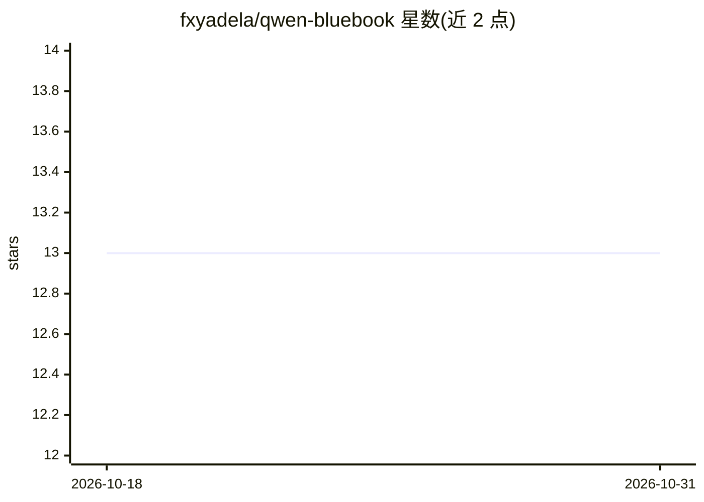

# fxyadela/qwen-bluebook

⭐ 13 · HTML · NOASSERTION · 推送 2026-09-07 · [GitHub](https://github.com/fxyadela/qwen-bluebook) · 组织维护 · 中文 README

**面向大学生的千问实操手册：13 个校园场景逐步指南**

以千问 APP 为使用示意的电子书/白皮书：从大学四年高频需求筛选 13 个场景，覆盖入学适应、课业学习与求职规划三阶段。每个场景按固定结构编写——适合人群、含逐步截图与指令原文的实操案例、结果复盘与可复用提示词模板（方括号标注可替换字段）。提供网页版单页阅读、PDF 与 Word 版本（后者经 GitHub Releases 下载）。由三位内容创作者与一名开发者协作完成，采用 CC BY-NC-ND 4.0 许可，声明与阿里巴巴无隶属关系。

## 筛选速览

| 维度 | 判定 | 备注 |
|---|---|---|
| AI 角色 | `ai-knowledge` | 知识聚合/清单类 |
| 许可风险 | `none` | NOASSERTION |
| 部署形态 | `None` |  |
| 模型依赖 | — | README 未给出锁定关系 |
| 硬件要求 | — | 无带数字的原话,不猜 |
| 安装摩擦 | `low` | 无编译、无系统依赖或容器化 |
| 成熟度 | — | 结构信号不足 |

## 能力要点

- 13 个场景共用同一结构：适合人群/实操案例/结果复盘/使用技巧
- 指令原文单独列出可直接复制，模板含可替换字段表
- 提供网页版、PDF 与 Word 三种阅读版本
- 附效率账本：四年节省时间约 3003 小时的实测与估算口径

## 适用场景

- 按场景查找课程学习、复习备考、简历求职等任务的 AI 提问方法
- 直接复制指令原文并替换为自己的资料上手使用
- 打印 PDF 或下载 Word 版离线阅读

## 场景标签

`教程课程` · 领域:学习与行业

## 证据(README 行号)

> L13: 所以，我们以千问APP作为产品使用示意，从大学四年最高频的真实需求出发，筛选出 13 个核心使用场景，覆盖入学适应、课业学习和求职规划三个阶段，并附上具体实操步骤，读者可直接将提问原文替换为自身情况，即可上手使用。
> L53: ## 每个场景怎么写的

## 星数曲线

2026-10-18 13 → 2026-10-31 13（+0）

---
*卡片 v1 · prompt 1.4 · 生成 2026-10-31 · 置信度 high · 依据 README sha `9f540257a002` · [字段定义](../../DATASET.md)*
