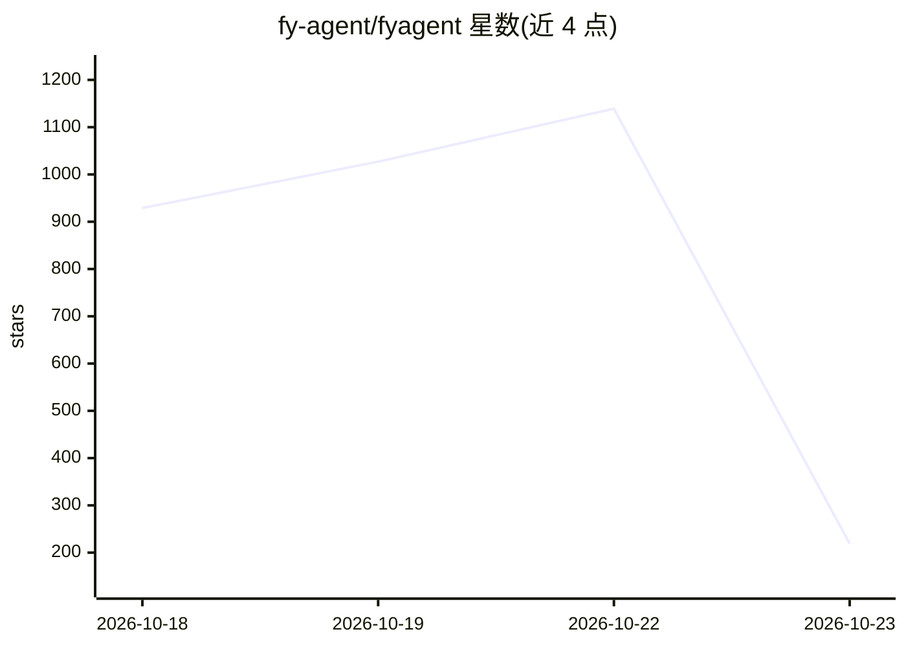

# fy-agent/fyagent

⭐ 219 · Rust · NOASSERTION · 推送 2026-10-22 · [GitHub](https://github.com/fy-agent/fyagent) · [官网](https://github.com/fy-agent/fyagent/releases/latest) · 组织维护 · 中文 README

**本地桌面应用：集中管理各 AI 编码工具的模型、账号与配置**

面向使用 AI Agent、AI Worker 和智能助手的用户，把多个 AI 桌面/CLI 软件（QoderWork CN、TRAE Work CN、Codex、Claude Code、OpenCode 等）的模型与 Provider 设置、账号认证、Skills、MCP 服务、提示词和长期记忆集中到一个本地桌面应用管理，写入前可预览变更。工作数据默认保存在本机 ~/.fyagent。提供 Windows（NSIS）与 macOS 安装包，macOS 构建经 Apple 公证；为源码可用软件，自有组件采用 PolyForm Noncommercial 许可证，商业使用须书面授权。项目自称仍在持续开发。

## 筛选速览

| 维度 | 判定 | 备注 |
|---|---|---|
| AI 角色 | `ai-ecosystem` | LLM/agent 周边工具 |
| 许可风险 | `none` | NOASSERTION |
| 部署形态 | `desktop` | 安装包/桌面程序 |
| 模型依赖 | — | README 未给出锁定关系 |
| 硬件要求 | — | 无带数字的原话,不猜 |
| 安装摩擦 | `low` | 无编译、无系统依赖或容器化 |
| 成熟度 | `idea` | |

## 能力要点

- 扫描并管理 7 种 AI 软件的模型/Provider/认证配置
- Skills 安装与分配、MCP 服务管理、提示词与长期记忆编辑
- 写入前预览变更，工作数据保存在本机 ~/.fyagent
- macOS 构建经 Apple Developer ID 签名与公证，发布附校验和与构建证明

## 适用场景

- 在一处查看和修改多个 AI 编码工具的模型与账号设置
- 为不同 AI 软件安装和分配 Skills 与 MCP 服务
- 管理 Claude Code/OpenClaw 等工具的提示词与长期记忆
- 检查本机 AI 软件的安装与连接状态

## 场景标签

`提示工程` · 领域:Agent 开发

## 证据(README 行号)

> L19: FyAgent 面向正在使用 AI Agent、AI Worker 和智能助手的人。它把模型从哪里来、能连接哪些工具、会哪些技能、遵循什么指令、保存怎样的配置，集中到一个本地桌面应用里。
> L29: |AI 软件配置|扫描 QoderWork CN、TRAE Work CN、WorkBuddy、Grok Build、Codex、Claude Code 和 OpenCode；在支持时提供安装、更新、启动、认证和资源分配入口|
> L32: |模型管理|为上述软件查看或修改模型与 Provider 设置；写入前预览变更，并在保存后检查结果|

## 星数曲线

2026-10-18 929 → 2026-10-23 219（-710）

---
*卡片 v1 · prompt 1.4 · 生成 2026-10-21 · 置信度 high · 依据 README sha `2f030e56b87e` · [字段定义](../../DATASET.md)*
