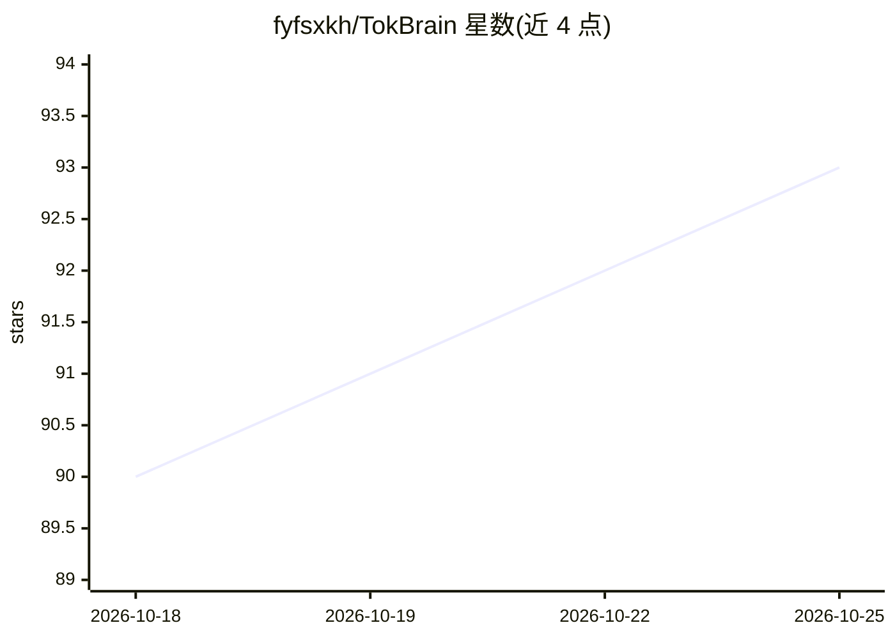

# fyfsxkh/TokBrain

⭐ 93 · Python · MIT · 推送 2026-10-24 · [GitHub](https://github.com/fyfsxkh/TokBrain) · 个人维护 · 中文 README

**把抖音公开作品整理成本地多模态知识库并支持 RAG 问答**

面向个人用户的本地优先知识库应用：粘贴公开作品链接预检或导入本地视频/文件夹/ZIP，经用户逐条确认后执行 ASR 语音转写、关键帧提取、OCR、结构化总结、分块与向量化，结果存入本机 SQLite，提供带来源的 RAG 问答（快速/深度两种模式）与 Obsidian Markdown 导出。OCR/ASR/总结/向量化/问答依赖阿里云百炼 API Key，需联网；数据与索引保存本机。当前版本仅支持 Windows，按单机单用户设计；依赖 F2 做链接解析（非官方机制，含风险声明与限流策略）。技术栈为 FastAPI+Next.js，通过安装/启动脚本运行。

## 筛选速览

| 维度 | 判定 | 备注 |
|---|---|---|
| AI 角色 | `ai-native` | 本体是模型或模型工具 |
| 许可风险 | `permissive` | MIT |
| 部署形态 | `desktop` | 安装包/桌面程序 |
| 模型依赖 | — | README 未给出锁定关系 |
| 硬件要求 | — | 无带数字的原话,不猜 |
| 安装摩擦 | `medium` | 含编译或系统依赖之一 |
| 成熟度 | — | 结构信号不足 |

## 能力要点

- 多模态处理链：ASR、关键帧提取、OCR、总结、分块与向量化
- 带来源的 RAG 问答，回答可回到本地摘要与原始公开来源
- 权限感知：仅作者明确允许下载才执行完整媒体流程，受限媒体只尝试字幕/音频
- Markdown 与本地图片可导出到 Obsidian

## 适用场景

- 把有权处理的抖音作品转成可检索的本地知识库
- 基于已入库作品内容做带来源的问答
- 将作品总结与关键资产导出到 Obsidian 继续整理

## 场景标签

`RAG` `知识库管理` · 领域:知识与检索

## 证据(README 行号)

> L33: |多模态处理|对允许处理的媒体执行语音转写、关键帧提取、OCR、总结、分块与向量化|
> L37: |有来源的 RAG 问答|提供快速/深度两种模式，回答可回到本地摘要与原始公开来源|

## 星数曲线

2026-10-18 90 → 2026-10-25 93（+3）

---
*卡片 v1 · prompt 1.4 · 生成 2026-10-23 · 置信度 high · 依据 README sha `0df56ee46c6f` · [字段定义](../../DATASET.md)*
