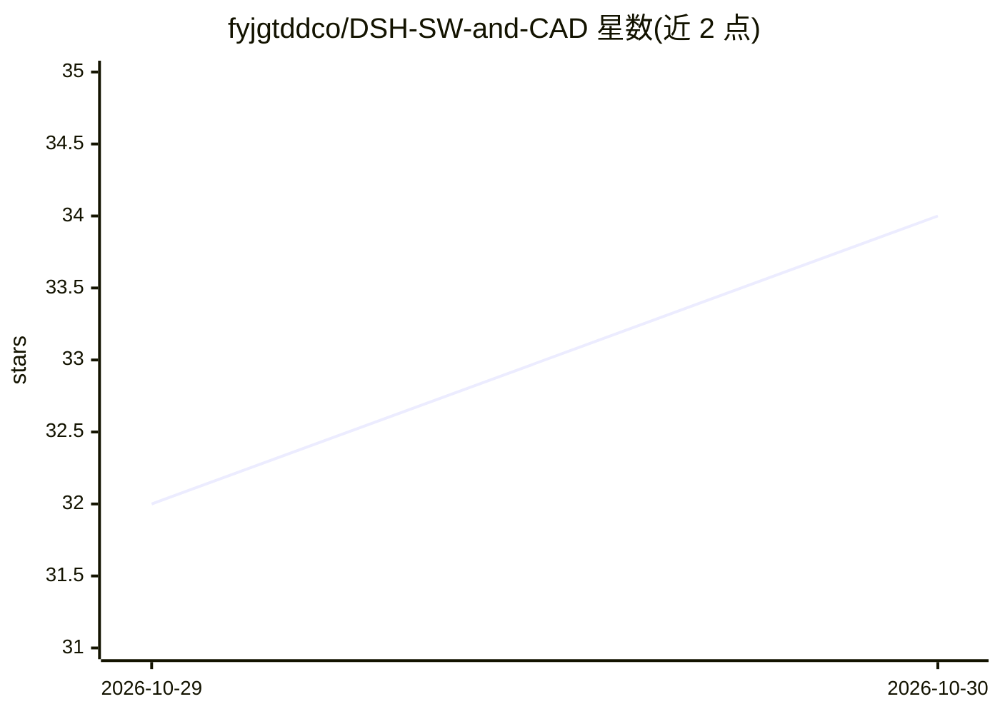

# fyjgtddco/DSH-SW-and-CAD

⭐ 34 · Python · MIT · 推送 2026-10-29 · [GitHub](https://github.com/fyjgtddco/DSH-SW-and-CAD) · 个人维护 · 中文 README

**驱动 SolidWorks 自动机械设计的 DSH 工程模式预设**

面向 DeepSeek Harness 0.2.x 的预设插件：以完成工程图纸为目标，流程覆盖需求访谈、十阶段设计分析、经 win32com 驱动 SolidWorks 2018-2025 三维建模、纯 Python 有限元与疲劳校核、三视图出图交付。通过 12 个门禁脚本以材料/物理/领域三道防线做代码级强制校验，凭据由宿主进程 HMAC 签名防伪造；多零件任务拆分为最多 24 个房间由子代理并行建模，SW 进程级 FIFO 锁排队。需 Windows、Python 3.8+、pywin32，一键安装脚本部署技能、UI 插件与门禁脚本。

## 筛选速览

| 维度 | 判定 | 备注 |
|---|---|---|
| AI 角色 | `ai-native` | 本体是模型或模型工具 |
| 许可风险 | `permissive` | MIT |
| 部署形态 | `desktop` | 安装包/桌面程序 |
| 模型依赖 | locked-api |  |
| 硬件要求 | — | 无带数字的原话,不猜 |
| 安装摩擦 | `low` | 无编译、无系统依赖或容器化 |
| 成熟度 | — | 结构信号不足 |

## 能力要点

- win32com 驱动 SolidWorks 2018~2025 建模，导出 SLDDRW/DWG/DXF/PDF
- 材料/物理/领域三大防线硬门禁，凭据由宿主 HMAC-SHA256 签名
- 求解器降级链 L0~L5：无外部 FEA 软件时用解析解/纯 Python FEA
- 多房间子代理并行建模，SW 单实例进程级 FIFO 锁

## 适用场景

- 用一句话需求让 AI 完成机械零件建模、校核与出图
- 多零件装配体拆分房间由子代理并行建模后总装
- 按 GB/T 规则对工程图做排版与几何校验

## 场景标签

`GUI 自动化` · 领域:效率与自动化

## 证据(README 行号)

> L3: > **面向 CAD / SolidWorks 机械设计的 DeepSeek Harness Agent 预设。**
> L50: |真的驱动 SolidWorks 建模|Python `win32com`，SW 2018 ~ 2025，单位 mm|

## 星数曲线

2026-10-29 32 → 2026-10-30 34（+2）

---
*卡片 v1 · prompt 1.4 · 生成 2026-10-28 · 置信度 high · 依据 README sha `177ce0e556ea` · [字段定义](../../DATASET.md)*
