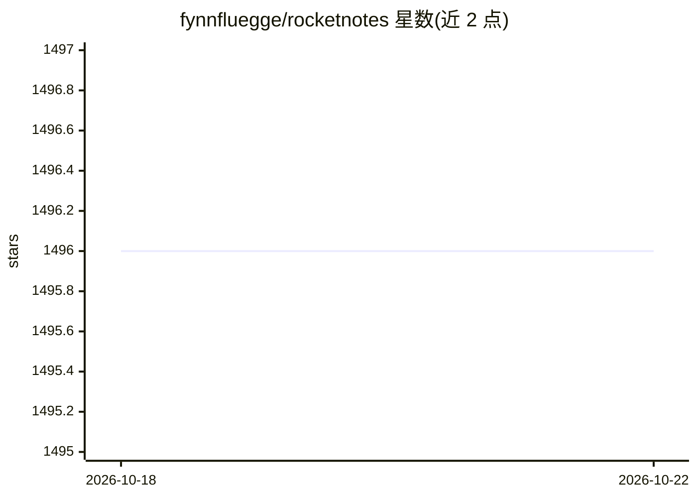

# fynnfluegge/rocketnotes

⭐ 1,496 · TypeScript · Apache-2.0 · 推送 2026-04-23 · [GitHub](https://github.com/fynnfluegge/rocketnotes) · 个人维护

**带原生 AI 功能的 Web/Electron Markdown 笔记应用，可全本地运行**

Web 端与 Electron 桌面端的 Markdown 笔记应用，面向个人知识管理用户：层级文档树、Zettelkasten 收件箱、语义搜索、文档分享等笔记功能之外，集成聊天问答、Copilot 式文本补全、语音转文字、AI agent 自动归档笔记片段等 AI 能力。支持 OpenAI、Anthropic、Together AI 模型，本地模式经 Docker 配合 Ollama 运行；技术栈含 Langchain/Langgraph、ChromaDB 或 S3 Vectors，云版部署于 AWS Serverless。另提供 MCP Server 与 Neovim 插件集成。

## 筛选速览

| 维度 | 判定 | 备注 |
|---|---|---|
| AI 角色 | `ai-native` | 本体是模型或模型工具 |
| 许可风险 | `permissive` | Apache-2.0 |
| 部署形态 | `None` |  |
| 模型依赖 | local-ok | 支持本地模型 |
| 硬件要求 | — | 无带数字的原话,不猜 |
| 安装摩擦 | `low` | 无编译、无系统依赖或容器化 |
| 成熟度 | — | 结构信号不足 |

## 能力要点

- 多 LLM 支持：OpenAI、Anthropic、Together AI
- Docker 本地模式配合 Ollama 实现 100% 本地 AI 处理
- AI agent 将 Zettelkasten 收件箱片段归档至相关文档
- 可将知识库作为 MCP Server 供任意 LLM 应用使用

## 适用场景

- 搭建个人 Zettelkasten 知识库并与自己的文档对话问答
- 不依赖云服务、全本地私有化运行笔记与 AI 功能
- 通过语音输入与 AI 补全加速笔记写作

## 场景标签

`知识库管理` `文档问答` · 领域:知识与检索

## 证据(README 行号)

> L17: Rocketnotes is a web-based Markdown note taking app with native AI feature integrations like chat, text completion,
> L42: - 🤖 **Chat with Your Documents**: Ask questions in natural language and get answers synthesized from your own docum
> L46: - 📦 **Local Mode with Docker**: Run the entire application on your own machine using Ollama for 100% local and priv

## 星数曲线

2026-10-18 1,496 → 2026-10-22 1,496（+0）

---
*卡片 v1 · prompt 1.4 · 生成 2026-10-21 · 置信度 high · 依据 README sha `146695d954bf` · [字段定义](../../DATASET.md)*
