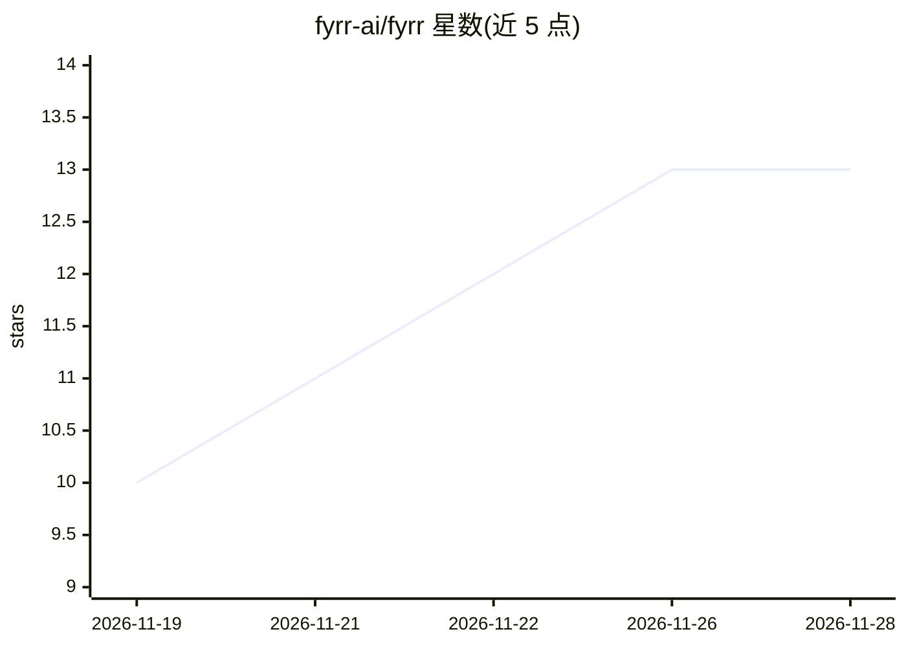

# fyrr-ai/fyrr

⭐ 13 · Rust · Apache-2.0 · 推送 2026-11-27 · [GitHub](https://github.com/fyrr-ai/fyrr) · [官网](https://fyrr.dev) · 组织维护

**给 AI agent 提供权限感知检索的无服务器上下文层**

用 Rust 编写的检索层，以 MCP 工具形式接入 Claude、Cursor 等应用，对其文档、聊天、工单和代码做混合搜索。数据以文件形式存于单个 S3 桶或本地目录，无需数据库；读取器可跑在 AWS Lambda 上按请求付费。核心机制是在排序前同步并校验文档访问规则，禁止文档如同不存在，缺权限数据时拒绝而非猜测。通过连接器同步 Google Drive、Notion、GitHub、Slack、Jira 等来源，可用 Python SDK 自写连接器。限制包括 pre-1.0 格式可能破坏性变更、无 PDF/Office 提取、仅支持 Linux。

## 筛选速览

| 维度 | 判定 | 备注 |
|---|---|---|
| AI 角色 | `ai-ecosystem` | LLM/agent 周边工具 |
| 许可风险 | `permissive` | Apache-2.0 |
| 部署形态 | `None` |  |
| 模型依赖 | — | README 未给出锁定关系 |
| 硬件要求 | — | 无带数字的原话,不猜 |
| 安装摩擦 | `low` | 无编译、无系统依赖或容器化 |
| 成熟度 | `idea` | |

## 能力要点

- 排序前进行权限检查，禁止文档如同不存在，缺权限数据时拒绝
- 以 MCP 工具（stdio/Streamable HTTP）接入 Claude、Cursor 等应用
- 数据全部存于一个 S3 桶或本地目录，读取器支持 AWS Lambda（实验性）
- 提供 Python SDK 编写自定义连接器

## 适用场景

- 让 Claude Code 直接搜索我本地的笔记和代码仓库
- 团队共享一个索引，成员各自的 agent 直接检索而无需常驻服务器
- 公司场景下在企业登录后部署带权限校验的统一文档检索
- 为训练与评测搭建固定不变的并行搜索索引

## 场景标签

`RAG` `语义搜索` · 领域:知识与检索

## 证据(README 行号)

> L3:  The serverless, permission-aware context layer for AI agents. No database. Just a bucket.
> L18: - **Find: works in the AI you already use.** Plug fyrr into Claude, Cursor or
> L20:  over stdio or Streamable HTTP (MCP tools).

## 星数曲线

2026-11-19 10 → 2026-11-28 13（+3）

---
*卡片 v1 · prompt 1.4 · 生成 2026-11-19 · 置信度 high · 依据 README sha `50a29fb0b5b4` · [字段定义](../../DATASET.md)*
