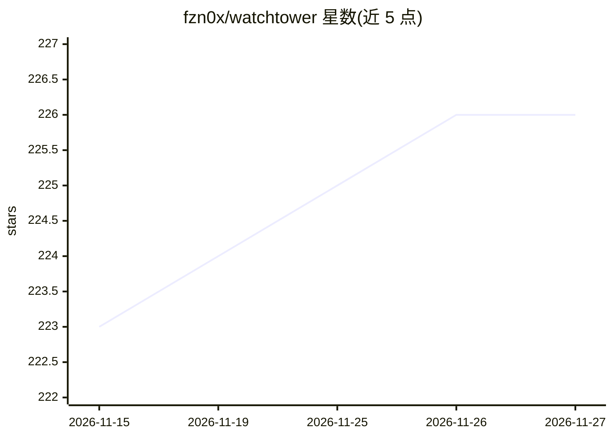

# fzn0x/watchtower

⭐ 226 · Python · MIT · 推送 2026-11-24 · [GitHub](https://github.com/fzn0x/watchtower) · [官网](https://fzn0x.github.io/watchtower/) · 个人维护

**面向授权测试者的 LLM Agent 渗透测试自动化 CLI**

以 LangGraph 状态机驱动的命令行渗透测试工具：Planner 决定下一步调用哪个安全工具，Worker 线程池并行执行（最多 5 个），Analyst 将工具原始输出解析为带严重级别的结构化 findings，Logic Analyst 检查业务逻辑与 IDOR 风险。内嵌 28 个安全工具（nuclei、subfinder、ffuf 等），支持交互式工具白名单勾选，结果存入 SQLite 并可导出 PDF 报告。要求 Python 3.10+，Linux/macOS 运行（Windows 经 WSL2），可用 Docker Compose 部署；不强制目标范围校验。

## 筛选速览

| 维度 | 判定 | 备注 |
|---|---|---|
| AI 角色 | `ai-ecosystem` | LLM/agent 周边工具 |
| 许可风险 | `permissive` | MIT |
| 部署形态 | `self-host` | docker 或自建部署 |
| 模型依赖 | local-ok | 支持本地模型 |
| 硬件要求 | — | 无带数字的原话,不猜 |
| 安装摩擦 | `low` | 无编译、无系统依赖或容器化 |
| 成熟度 | — | 结构信号不足 |

## 能力要点

- Planner/Worker/Analyst/Logic Analyst 四节点 LangGraph 多 Agent 架构
- 集成 28 个安全工具，交互式清单限定 AI 可用工具范围
- LLM 无关：支持 OpenAI、Gemini、OpenRouter、Claude、LiteLLM 及 Ollama 等本地模型
- 运行历史存 SQLite，按 run 导出 PDF 报告

## 适用场景

- 对已授权的网站或主机执行自动化渗透测试流程
- 红队工作中并行侦察并生成结构化漏洞报告
- 在 CI/脚本中以 headless 模式批量运行安全测试
- 用本地模型运行测试，使数据不出本机

## 场景标签

`多智能体` `网络安全` · 领域:Agent 开发

## 证据(README 行号)

> L22: **Watchtower** is an AI-powered penetration testing automation CLI. It uses LLMs and LangGraph to run an agentic lo
> L31: - **Multi-agent architecture**: a Planner picks the next tools, a Worker runs them (in parallel when asked), an Ana
> L44: Watchtower compiles a LangGraph state machine with four nodes and runs it until the planner decides the test is fin

## 星数曲线

2026-11-15 223 → 2026-11-27 226（+3）

---
*卡片 v1 · prompt 1.4 · 生成 2026-11-26 · 置信度 mid · 依据 README sha `d059260b2983` · [字段定义](../../DATASET.md)*
