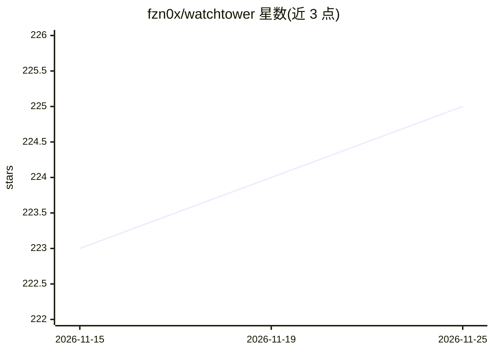

# fzn0x/watchtower

⭐ 225 · Python · MIT · 推送 2026-11-15 · [GitHub](https://github.com/fzn0x/watchtower) · [官网](https://fzn0x.github.io/watchtower/) · 个人维护

**给安全测试人员的 LLM Agent 编排渗透测试自动化 CLI**

面向授权安全测试的 Python CLI 工具，用 LLM 与 LangGraph 编排多 Agent 工作流：Planner 选工具、Worker 并行执行、Analyst 将输出转为结构化发现、Logic Analyst 查业务逻辑与 IDOR 风险。集成 28 个安全工具（网络、Web 侦察、DNS、漏洞、TLS、密钥扫描等），运行历史存 SQLite 并导出 PDF 报告。模型接入可选：OpenAI、Gemini、OpenRouter、Claude、LiteLLM，或通过 Ollama/LM Studio/llama.cpp/vLLM 本地运行。要求 Python 3.10+，工具运行需 Linux/macOS（Windows 经 WSL2），仅限授权测试。

## 筛选速览

| 维度 | 判定 | 备注 |
|---|---|---|
| AI 角色 | `ai-native` | 本体是模型或模型工具 |
| 许可风险 | `permissive` | MIT |
| 部署形态 | `None` |  |
| 模型依赖 | local-ok | 支持本地模型 |
| 硬件要求 | — | 无带数字的原话,不猜 |
| 安装摩擦 | `low` | 无编译、无系统依赖或容器化 |
| 成熟度 | — | 结构信号不足 |

## 能力要点

- Planner/Worker/Analyst/Logic Analyst 多 Agent 架构
- 集成 28 个安全工具，支持并行侦察与长输出截断
- SQLite 运行历史与 PDF 报告导出
- 支持 Ollama/LM Studio/llama.cpp/vLLM 等本地模型，数据不离开本机

## 适用场景

- 对自己的网站做授权渗透测试并生成 PDF 报告
- 用本地 LLM 跑安全侦察，避免提示与发现外泄
- 自动化整合多个安全工具的输出为结构化发现

## 场景标签

`网络安全` `多智能体` · 领域:Agent 开发

## 证据(README 行号)

> L20: **Watchtower** is an AI-powered penetration testing automation CLI that uses LLMs and LangGraph to orchestrate agen
> L27: - **Multi-agent architecture**: a Planner picks the next tools, a Worker runs them (in parallel when asked), an Ana

## 星数曲线

2026-11-15 223 → 2026-11-25 225（+2）

---
*卡片 v1 · prompt 1.4 · 生成 2026-11-17 · 置信度 high · 依据 README sha `17a770044893` · [字段定义](../../DATASET.md)*
