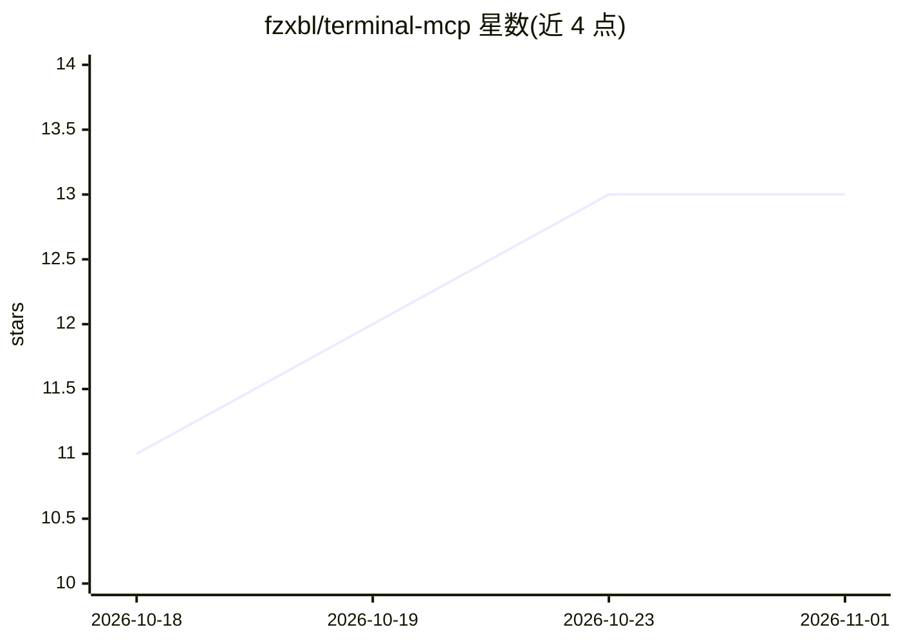

# fzxbl/terminal-mcp

⭐ 13 · Go · MIT · 推送 2026-10-14 · [GitHub](https://github.com/fzxbl/terminal-mcp) · 个人维护 · 中文 README

**给 LLM agent 提供真实 PTY 终端的 MCP 服务器，支持人类接管**

用 Go 编写的 Model Context Protocol 服务器，向 LLM agent 提供持久伪终端（PTY）会话，可驱动 gdb、python、ssh、vim 等交互式程序。每个会话附带实时 Web 终端 URL，人类可观看 agent 操作并随时接管同一会话，释放后 agent 以 [rc=n] $ command 形式获得人类操作记录继续执行。附带哨兵提示符判定命令边界、跨 shell 切换自动重注入 ulimit 资源上限、append-only 会话日志与 JSON 审计、会话级路由支持负载均衡后水平扩展。单二进制分发，可嵌入既有 MCP 服务器作库使用。限制：非完全无状态，PTY 会话固定于创建节点不可迁移；ulimit 无法约束提权至 root 的进程。

## 筛选速览

| 维度 | 判定 | 备注 |
|---|---|---|
| AI 角色 | `ai-ecosystem` | LLM/agent 周边工具 |
| 许可风险 | `permissive` | MIT |
| 部署形态 | `library` | 以包/库形式分发 |
| 模型依赖 | — | README 未给出锁定关系 |
| 硬件要求 | — | 无带数字的原话,不猜 |
| 安装摩擦 | `low` | 无编译、无系统依赖或容器化 |
| 成熟度 | — | 结构信号不足 |

## 能力要点

- 真实 PTY 持久会话，支持交互式与全屏程序（gdb/vim/top 等）
- 人类实时观看并可接管同一会话，释放后 agent 获得完整操作上下文
- 模型不可见的 ulimit 资源上限，跨 ssh/su/容器切换重注入
- session_id 内嵌属主节点地址实现跨节点反向代理与水平扩展

## 适用场景

- 让编码 agent 在真实终端里 ssh 到服务器排障、tail 日志
- agent 执行危险操作时我随时接管输密码或纠正，再交还
- 多用户/多 agent 并发跑终端会话并审计全部工具调用

## 场景标签

`编码 Agent` · 领域:编码与开发

## 证据(README 行号)

> L13: `terminal-mcp` is a Model Context Protocol server that gives an LLM agent a **real PTY terminal** (not a one-shot `
> L17: Built in Go, single binary, official MCP SDK, Streamable HTTP. Drop it into Cursor, Claude, Comate, or any MCP clie

## 星数曲线

2026-10-18 11 → 2026-11-01 13（+2）

---
*卡片 v1 · prompt 1.4 · 生成 2026-10-31 · 置信度 high · 依据 README sha `cc524d6b110c` · [字段定义](../../DATASET.md)*
