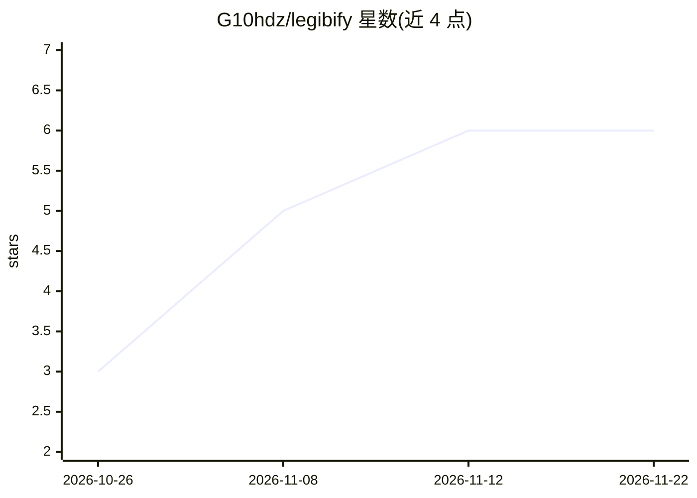

# G10hdz/legibify

⭐ 6 · HTML · Apache-2.0 · 推送 2026-10-10 · [GitHub](https://github.com/G10hdz/legibify) · [官网](https://g10hdz.github.io/legibify/) · 个人维护

**把 PR/提交/代码片段转成分层可核验解释的 agent 技能**

一个遵循 Agent Skills（SKILL.md）规范的技能，配合 Claude Code、Cursor、Gemini CLI 等 agent 使用：输入 PR、提交或代码片段，按层输出——3 行 verdict、按执行顺序并锚定 file:line 的 walkthrough、变更影响图，以及单个离线 HTML 交互解释器（图探索、引导讲解、理解测试，问题可导出到 Anki/Obsidian）。agent 只写 JSON 模型，Node 脚本校验并渲染，另有浏览器视觉自检。无需 API key 与服务器，UI 支持英文与西班牙语，支持 attach 模式写入 PR 正文。Apache-2.0。

## 筛选速览

| 维度 | 判定 | 备注 |
|---|---|---|
| AI 角色 | `ai-ecosystem` | LLM/agent 周边工具 |
| 许可风险 | `permissive` | Apache-2.0 |
| 部署形态 | `library` | 以包/库形式分发 |
| 模型依赖 | — | README 未给出锁定关系 |
| 硬件要求 | — | 无带数字的原话,不猜 |
| 安装摩擦 | `low` | 无编译、无系统依赖或容器化 |
| 成熟度 | — | 结构信号不足 |

## 能力要点

- 分层输出：3 行 verdict → file:line walkthrough → blast radius → 交互 HTML
- agent 只生成 JSON 模型，build.mjs 校验（0 错 0 警才构建）保证同模型同输出
- check.mjs 用 playwright-core 在真实浏览器自检布局（桌面+手机）
- 单个离线 HTML：无 CDN、无服务器、无账号、无 API key

## 适用场景

- code review 时快速理解一个 PR 改了什么、风险在哪
- 向团队解释仓库中某个系统或流程（topic 模式）
- 把可核验的解释附加到 PR 描述中供后续复用
- 用理解测试题目生成 Anki/Obsidian 学习卡片

## 场景标签

`代码审查` · 领域:编码与开发

## 证据(README 行号)

> L16: legibify is an agent skill for explaining code changes to humans. It works with Claude Code, Cursor, Gemini CLI, Gi
> L49: your agent ──writes──▶ model.json ──build.mjs──▶ explainer.html ──check.mjs──▶ screenshots

## 星数曲线

2026-10-26 3 → 2026-11-22 6（+3）

---
*卡片 v1 · prompt 1.4 · 生成 2026-11-20 · 置信度 high · 依据 README sha `b0e5db528fba` · [字段定义](../../DATASET.md)*
