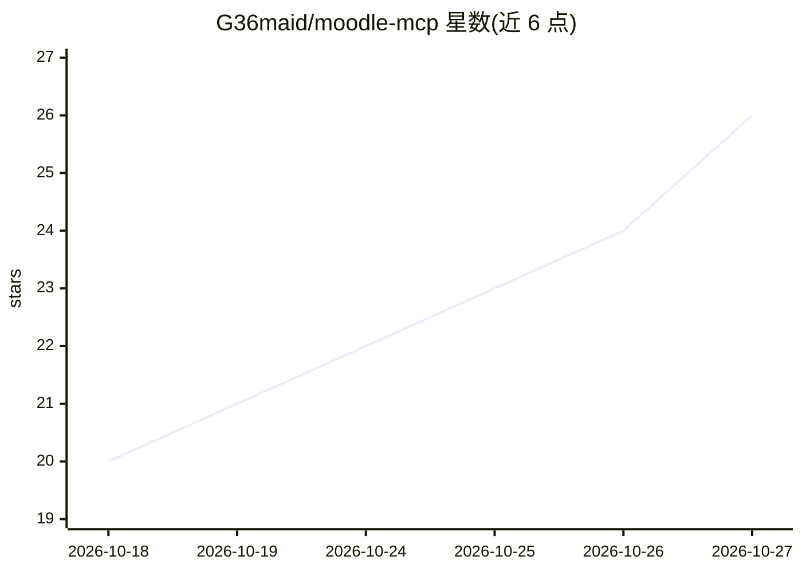

# G36maid/moodle-mcp

⭐ 26 · Rust · MIT · 推送 2026-10-20 · [GitHub](https://github.com/G36maid/moodle-mcp) · [官网](https://moodle.ntnu.cc) · 个人维护 · 中文 README

**让 AI agent 操作 Moodle 的 MCP 服务器，覆盖课程作业论坛成绩**

用 Rust 基于官方 MCP SDK（rmcp）编写的单一静态二进制 MCP 服务器，使 LLM agent 以用户身份登录 Moodle：提供 20 个类型化工具读取课程、抓取作业 PDF 并转 markdown、上传提交作业、读论坛与成绩，另有 opt-in 的 call_ws_function 逃生舱可调用约 350 个 web service 函数。已对 Moodle 3.7/4.5/5.2 实测验证。写入类工具需用户确认，提交保持草稿，不支持代考测验。适用 Moodle 3.7–5.x 且站点启用移动端 web service 的用户。

## 筛选速览

| 维度 | 判定 | 备注 |
|---|---|---|
| AI 角色 | `ai-ecosystem` | LLM/agent 周边工具 |
| 许可风险 | `permissive` | MIT |
| 部署形态 | `library` | 以包/库形式分发 |
| 模型依赖 | — | README 未给出锁定关系 |
| 硬件要求 | — | 无带数字的原话,不猜 |
| 安装摩擦 | `medium` | 含编译或系统依赖之一 |
| 成熟度 | — | 结构信号不足 |

## 能力要点

- 20 个类型化工具 + 2 个逃生舱覆盖完整学生流程
- 单一静态二进制，工具以本地文件路径传递而非 base64
- 每层结果嵌入下一步所需 ID，供 agent 自行链接调用
- 写入工具默认确认、提交保持草稿，代考测验刻意不提供

## 适用场景

- 让 AI agent 读取作业题目与附件 PDF 并代写提交草稿
- 汇总各课程截止日期生成学习计划
- 补看某门课本周公告与论坛讨论

## 场景标签

 · 领域:教育/agent 工具

## 证据(README 行号)

> L21: A Model Context Protocol server that lets
> L27: Built in Rust on the official MCP SDK (`rmcp`).
> L36: moodle-mcp signs the agent in as you. 20 typed tools cover the full student

## 星数曲线

2026-10-18 20 → 2026-10-27 26（+6）

---
*卡片 v1 · prompt 1.4 · 生成 2026-10-27 · 置信度 mid · 依据 README sha `d6368600c6d7` · [字段定义](../../DATASET.md)*
