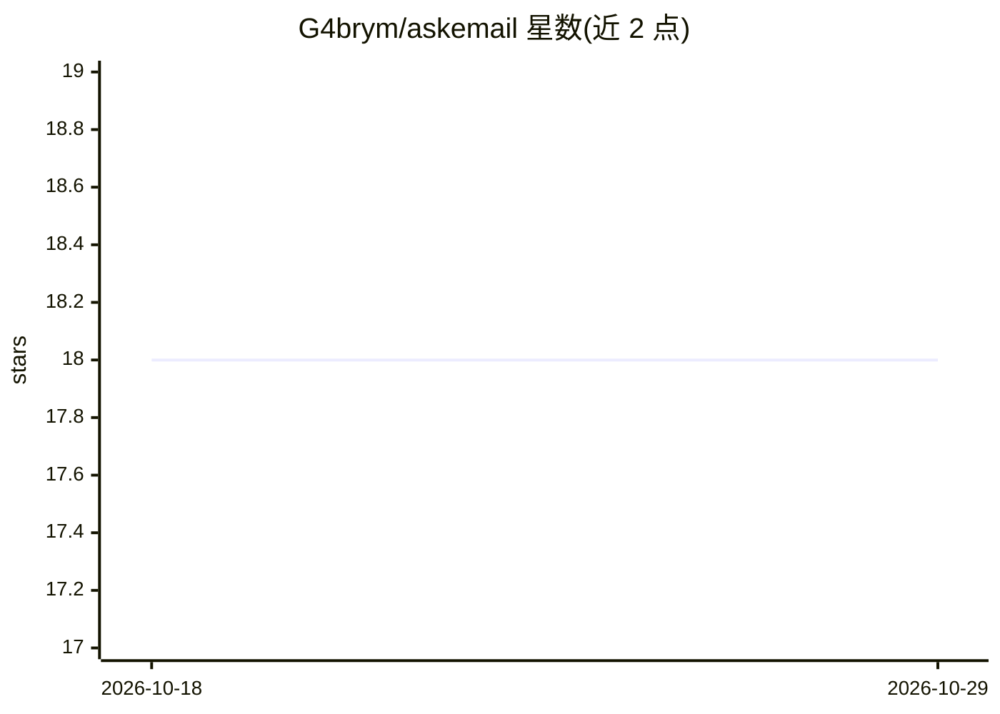

# G4brym/askemail

⭐ 18 · TypeScript · MIT · 推送 2026-03-08 · [GitHub](https://github.com/G4brym/askemail) · 个人维护

**自托管的 AI 邮件助手：转发邮件获得智能回复**

基于 Cloudflare Workers 的无服务器 AI 邮件助手：接收转发的邮件，调用 Google Gemini 2.0 Flash 模型分析内容与附件（附件经 Workers AI toMarkdown 转换），生成长邮件串摘要与上下文相关回复；可选启用基于向量数据库的对话记忆，支持显式存储/遗忘。面向想在自有 Cloudflare 基础设施上自托管的用户，也提供托管服务。部署需 Node.js/npm、Cloudflare 账号与 Google AI Studio API key，并通过 Cloudflare Email Routing 将邮件路由到 Worker。

## 筛选速览

| 维度 | 判定 | 备注 |
|---|---|---|
| AI 角色 | `ai-native` | 本体是模型或模型工具 |
| 许可风险 | `permissive` | MIT |
| 部署形态 | `library` | 以包/库形式分发 |
| 模型依赖 | — | README 未给出锁定关系 |
| 硬件要求 | — | 无带数字的原话,不猜 |
| 安装摩擦 | `low` | 无编译、无系统依赖或容器化 |
| 成熟度 | — | 结构信号不足 |

## 能力要点

- 邮件内容与附件处理，长邮件串摘要
- 使用 Google Gemini 2.0 Flash 模型生成回复
- 可选向量数据库对话记忆（存储/遗忘）
- 默认不存储数据，可完全自托管

## 适用场景

- 把无聊或冗长的邮件转发出去，收到智能处理后的回复
- 在自己控制的 Cloudflare 基础设施上运行隐私优先的邮件助手
- 为邮件往来保留可管理的对话记忆

## 场景标签

`AI 助手` · 领域:对话与助手

## 证据(README 行号)

> L9: AskEmail is an open-source AI email assistant that processes emails and provides intelligent responses using Google'
> L17: AskEmail is a serverless AI assistant that processes emails and provides intelligent responses. It leverages Cloudf

## 星数曲线

2026-10-18 18 → 2026-10-29 18（+0）

---
*卡片 v1 · prompt 1.4 · 生成 2026-10-29 · 置信度 high · 依据 README sha `0978e42185f9` · [字段定义](../../DATASET.md)*
