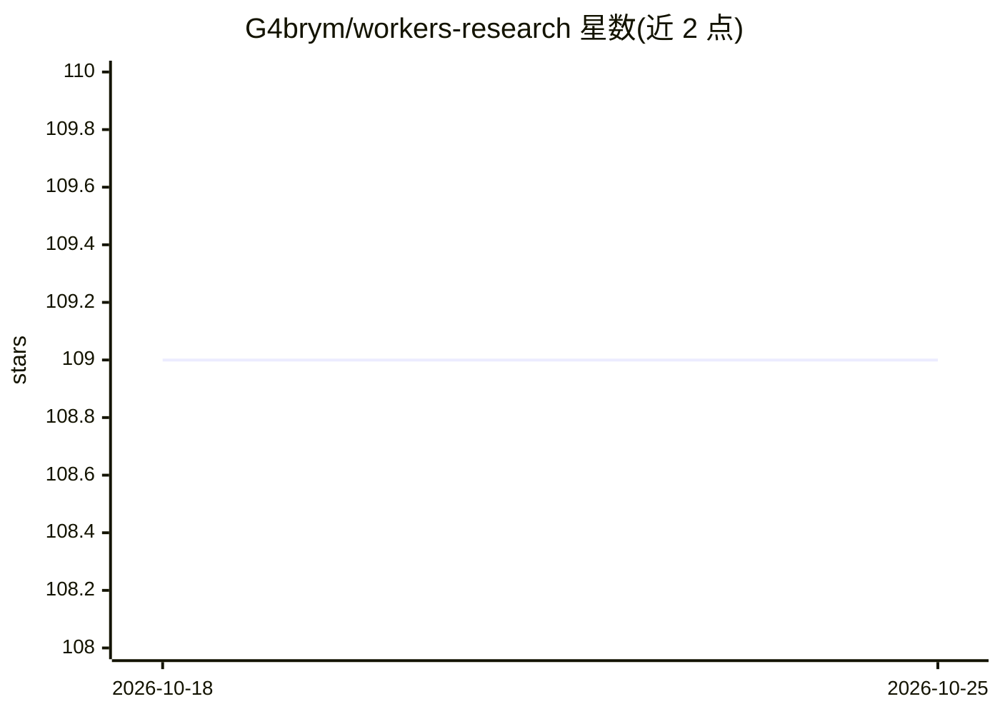

# G4brym/workers-research

⭐ 109 · TypeScript · MIT · 推送 2026-03-15 · [GitHub](https://github.com/G4brym/workers-research) · 个人维护

**部署在 Cloudflare Workers 上的深度研究 agent，生成研究报告**

基于 Cloudflare Workers/Workflows 的无服务器深度研究代理：用户输入研究问题并回答澄清性追问后，系统用 Google Gemini 2.5 迭代执行多步研究，经 Browser Rendering 抓取网页，产出研究报告；支持可选的 AutoRAG（对预索引数据集检索）与 Cloudflare AI Gateway 代理，D1 数据库存储数据，Hono/JSX 提供仪表盘，可对已完成报告做基于内容的追问。多数研究在 5-10 分钟内完成，免费版 Browser Rendering 每日限 10 分钟。部署需 Cloudflare 账号、D1 数据库与 Google AI Studio API key。

## 筛选速览

| 维度 | 判定 | 备注 |
|---|---|---|
| AI 角色 | `ai-native` | 本体是模型或模型工具 |
| 许可风险 | `permissive` | MIT |
| 部署形态 | `library` | 以包/库形式分发 |
| 模型依赖 | — | README 未给出锁定关系 |
| 硬件要求 | — | 无带数字的原话,不猜 |
| 安装摩擦 | `low` | 无编译、无系统依赖或容器化 |
| 成熟度 | — | 结构信号不足 |

## 能力要点

- Gemini 2.5 迭代多步研究并生成格式化报告
- Cloudflare Workflows 管理研究执行，D1 存储数据
- 可选 AutoRAG 对预索引数据集检索作为网页研究的替代
- 对已完成报告的追问回答基于报告内容

## 适用场景

- 为论文或课题快速收集资料并生成综述报告
- 调研行业趋势与竞品做市场分析
- 为博客/文章生成主题研究底稿

## 场景标签

`科研工具` · 领域:学习与行业

## 证据(README 行号)

> L3: **A serverless, Cloudflare Workers-based Deep Research Agent powered by Google Gemini 2.5.**
> L9: - **In-depth Research with Google Gemini 2.5:** Leverages Google's latest models for high-quality research reports.
> L41: - **Google Gemini 2.5:** Advanced language model for reports.

## 星数曲线

2026-10-18 109 → 2026-10-25 109（+0）

---
*卡片 v1 · prompt 1.4 · 生成 2026-10-23 · 置信度 high · 依据 README sha `7fa0e5a6e328` · [字段定义](../../DATASET.md)*
