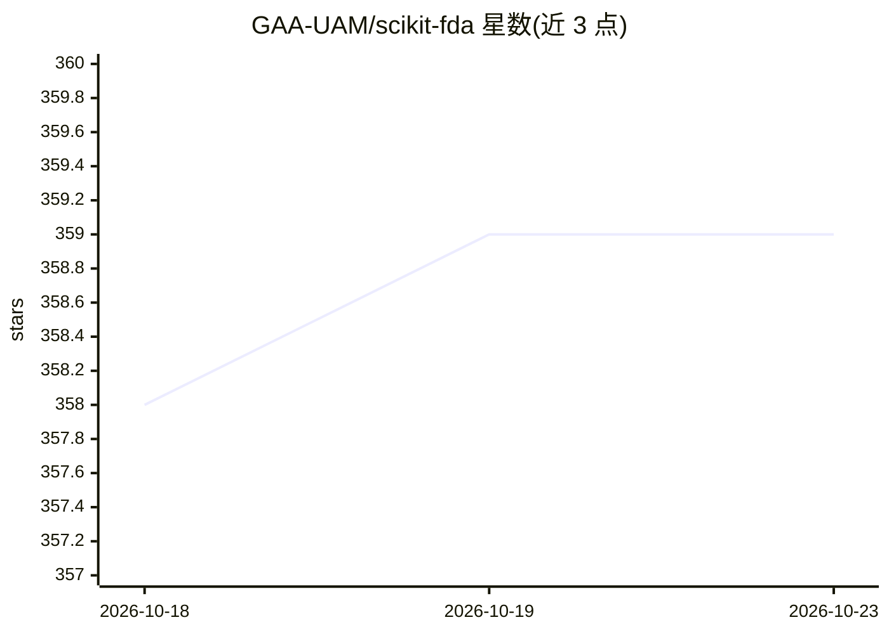

# GAA-UAM/scikit-fda

⭐ 359 · Python · BSD-3-Clause · 推送 2026-10-09 · [GitHub](https://github.com/GAA-UAM/scikit-fda) · [官网](https://fda.readthedocs.io) · 组织维护

**函数型数据分析（FDA）Python 库：为依赖连续参数的数据提供统计工具**

面向统计分析用户的功能数据分析 Python 包：为依赖连续参数（如曲线）的数据提供表示、探索性分析、预处理、对齐/配准等工具，并支持函数型数据的推断、分类、回归与聚类。以 Python 库形式发布，兼容 scikit-learn 风格数据集，支持 Python 3.8 以上版本，跨平台，依赖通过 pip 自动安装。由马德里自治大学团队维护，附论文引用与 BSD 3-Clause 许可。

## 筛选速览

| 维度 | 判定 | 备注 |
|---|---|---|
| AI 角色 | `ai-native` | 本体是模型或模型工具 |
| 许可风险 | `permissive` | BSD-3-Clause |
| 部署形态 | `library` | 以包/库形式分发 |
| 模型依赖 | — | README 未给出锁定关系 |
| 硬件要求 | — | 无带数字的原话,不猜 |
| 安装摩擦 | `low` | 无编译、无系统依赖或容器化 |
| 成熟度 | — | 结构信号不足 |

## 能力要点

- 函数型数据的表示、预处理与探索性分析工具
- 支持函数型数据的分类、回归、聚类与推断
- 对齐/配准（alignment、registration）功能
- 兼容 scikit-learn 与 conda-forge/PyPI 安装

## 适用场景

- 对曲线等连续参数数据进行统计建模与分类
- 函数型数据的预处理、对齐与降维分析
- 科研工作流中复现与引用 FDA 方法（附 JSS 论文）

## 场景标签

 · 领域:统计/科学计算

## 证据(README 行号)

> L8: Functional Data Analysis, or FDA, is the field of Statistics that analyses
> L11: This package offers classes, methods and functions to give support to FDA
> L14: such as inference, classification, regression or clustering of functional data.

## 星数曲线

2026-10-18 358 → 2026-10-23 359（+1）

---
*卡片 v1 · prompt 1.4 · 生成 2026-10-21 · 置信度 high · 依据 README sha `401f0936b9dd` · [字段定义](../../DATASET.md)*
