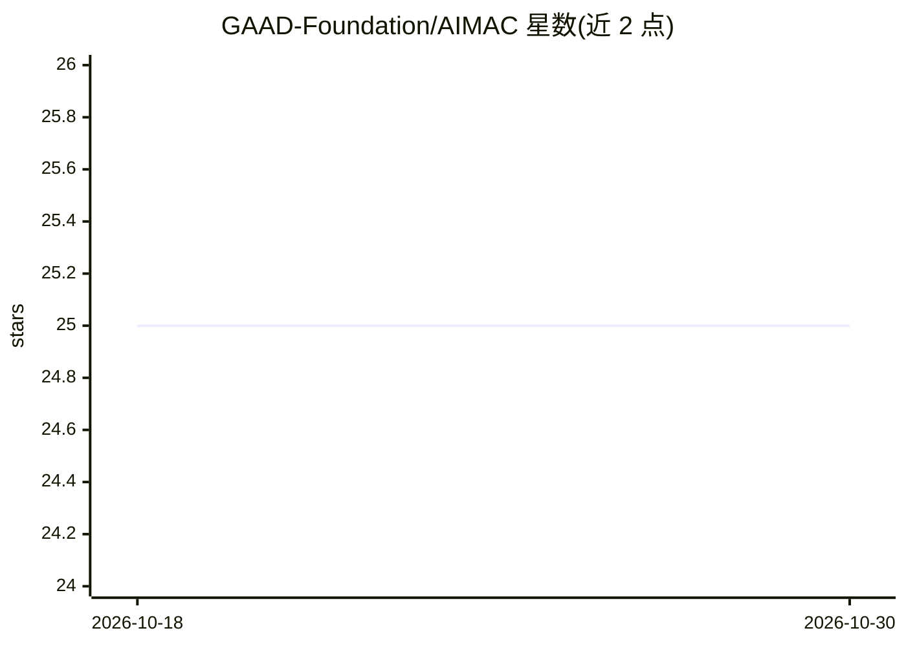

# GAAD-Foundation/AIMAC

⭐ 25 · Python · MIT · 推送 2025-12-12 · [GitHub](https://github.com/GAAD-Foundation/AIMAC) · [官网](https://aimac.ai) · 组织维护

**评测 LLM 生成网页无障碍性的基准工具**

AIMAC 通过 OpenRouter API 调用多个 LLM 生成 HTML 页面，用 Playwright 并行截图渲染页面，再以 Axe-core 运行无障碍检查，按 Serious 与 Critical 违规项对模型打分与排名，含防止单一规则主导的衰减机制。提供 TSV/pretty/JSON 三种报告格式，TSV 默认输出兼容屏幕阅读器与 Unix 管道。需要 Python 3.12+、uv 与 OPENROUTER_API_KEY，数据与快照存于本地数据库与 output 目录。

## 筛选速览

| 维度 | 判定 | 备注 |
|---|---|---|
| AI 角色 | `ai-ecosystem` | LLM/agent 周边工具 |
| 许可风险 | `permissive` | MIT |
| 部署形态 | `None` |  |
| 模型依赖 | locked-api |  |
| 硬件要求 | — | 无带数字的原话,不猜 |
| 安装摩擦 | `low` | 无编译、无系统依赖或容器化 |
| 成熟度 | — | 结构信号不足 |

## 能力要点

- 经 OpenRouter 调用多 LLM 生成 HTML 并截图
- Axe-core 无障碍检查与衰减式打分排名
- TSV/pretty/JSON 报告，默认输出适配屏幕阅读器
- 结果缓存、快照存档与密封测试

## 适用场景

- 对比不同 LLM 生成网页的 WCAG 无障碍合规表现
- 以 JSON 输出脚本化提取榜单与模型数据
- 导出无障碍基准报告用于研究引用

## 场景标签

`模型评测` · 领域:评测与运维

## 证据(README 行号)

> L3: AIMAC is a tool for evaluating the accessibility of web pages generated by various LLMs via the OpenRouter API.
> L8: - **Scores and compares** model performance based on Serious and Critical axe-core violations, with dampening to pre

## 星数曲线

2026-10-18 25 → 2026-10-30 25（+0）

---
*卡片 v1 · prompt 1.4 · 生成 2026-10-27 · 置信度 high · 依据 README sha `0fb21b25464d` · [字段定义](../../DATASET.md)*
