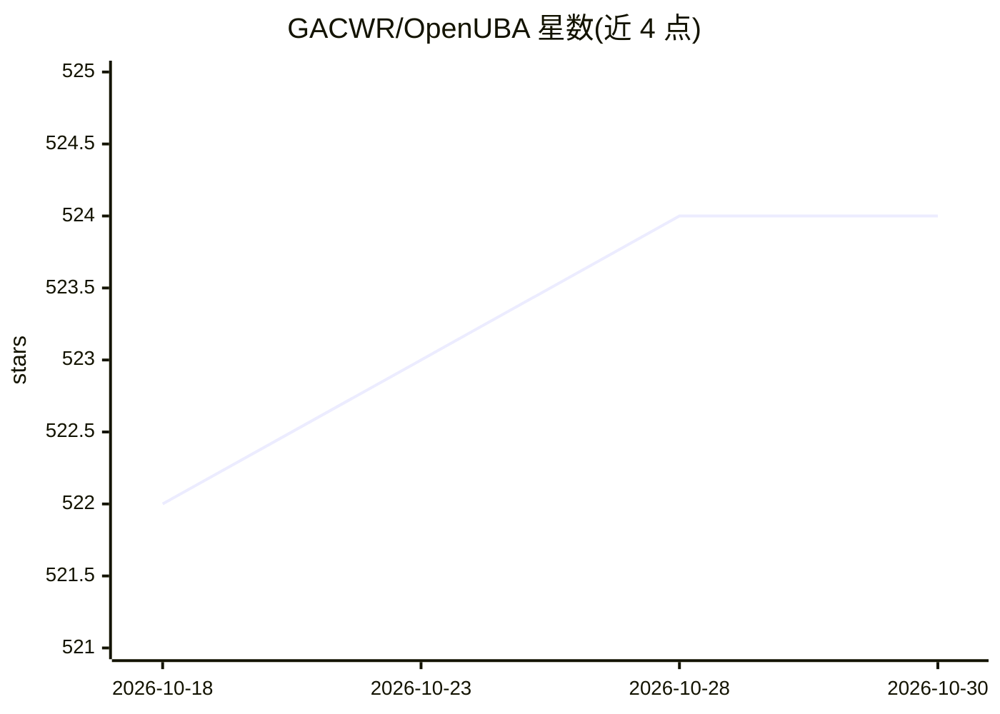

# GACWR/OpenUBA

⭐ 524 · Python · Apache-2.0 · 推送 2026-10-17 · [GitHub](https://github.com/GACWR/OpenUBA) · [官网](http://openuba.org) · 组织维护

**开源 UEBA 安全分析框架：模型管理、规则引擎与行为异常检测平台**

面向安全分析师的用户与实体行为分析（UEBA）平台，采用'开放模型'理念，模型可审查、可审计。提供模型全生命周期管理（安装/训练/推理）、多注册源（OpenUBA Hub/GitHub/HuggingFace/本地）、可视化流图规则引擎与告警、案例管理与实体风险跟踪。Kubernetes 原生架构，前端 Next.js、后端 FastAPI，数据层 PostgreSQL/Elasticsearch/Spark；模型在 Docker 容器或 K8s Job 中隔离执行，支持 sklearn/PyTorch/TensorFlow/NetworkX 等框架，提供 Python SDK（pip install openuba）与 JupyterLab 工作区。

## 筛选速览

| 维度 | 判定 | 备注 |
|---|---|---|
| AI 角色 | `ai-ecosystem` | LLM/agent 周边工具 |
| 许可风险 | `permissive` | Apache-2.0 |
| 部署形态 | `library` | 以包/库形式分发 |
| 模型依赖 | — | README 未给出锁定关系 |
| 硬件要求 | — | 无带数字的原话,不猜 |
| 安装摩擦 | `low` | 无编译、无系统依赖或容器化 |
| 成熟度 | — | 结构信号不足 |

## 能力要点

- 模型全生命周期管理与多注册源支持（GitHub/OpenUBA Hub/HuggingFace/Kubeflow/本地）
- 可视化流图规则引擎，规则确定性地序列化为 JSON 可审计
- 模型执行在 Docker 容器/K8s Job 中隔离运行，安装与执行前做密码学哈希校验
- 支持 sklearn/PyTorch/TensorFlow/Keras/NetworkX/Spark MLlib 多框架模型

## 适用场景

- 安全分析师构建行为异常检测与告警规则
- 以可审查的白盒模型满足合规与调查需求
- 团队管理安全模型的训练、推理与案例处置全流程
- 在 JupyterLab 工作区中注册模型并提交训练/推理作业

## 场景标签

`网络安全` · 领域:学习与行业

## 证据(README 行号)

> L107: - Model management with full lifecycle (install, train, infer)
> L114: - Framework-agnostic: supports sklearn, PyTorch, TensorFlow, Keras, NetworkX, Spark MLlib, and more
> L125: - Launch managed JupyterLab environments from the UI with configurable hardware tiers

## 星数曲线

2026-10-18 522 → 2026-10-30 524（+2）

---
*卡片 v1 · prompt 1.4 · 生成 2026-10-21 · 置信度 high · 依据 README sha `76500a462244` · [字段定义](../../DATASET.md)*
