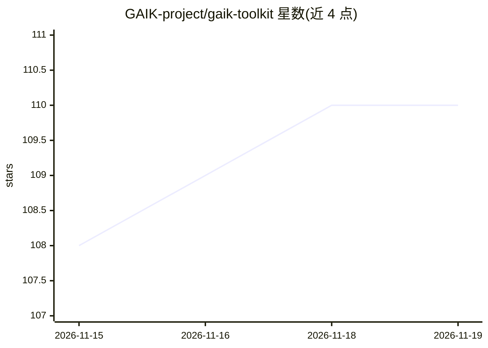

# GAIK-project/gaik-toolkit

⭐ 110 · Python · MIT · 推送 2026-11-18 · [GitHub](https://github.com/GAIK-project/gaik-toolkit) · [官网](https://gaik-project.github.io/gaik-toolkit/) · 组织维护

**面向企业的生成式 AI 知识管理工具包：组件+指南+方案向导**

GAIK 项目（gaik.ai）的生成式 AI 知识管理工具包，提供从战略规划到可部署实现的组件与指南：按策略/需求/业务/实现/评估/安全合规/指导七层组织。覆盖知识捕获、知识访问、知识合成三类知识过程；Python 组件通过统一 ProviderClient 接口接入 OpenAI、Azure OpenAI、Google Gemini/Vertex、Anthropic、CSC Aitta 及 OpenAI 兼容服务器。含 Solution Configuration Wizard，从自然语言业务问题出发生成蓝图、BPMN 图与可运行 PoC；桌面应用为实验性。MIT 许可。

## 筛选速览

| 维度 | 判定 | 备注 |
|---|---|---|
| AI 角色 | `ai-ecosystem` | LLM/agent 周边工具 |
| 许可风险 | `permissive` | MIT |
| 部署形态 | `desktop` | 安装包/桌面程序 |
| 模型依赖 | locked-api |  |
| 硬件要求 | — | 无带数字的原话,不猜 |
| 安装摩擦 | `low` | 无编译、无系统依赖或容器化 |
| 成熟度 | — | 结构信号不足 |

## 能力要点

- 七层架构：从用例选择到安全合规的开发指南与模板
- 统一 ProviderClient 接口接入多家模型提供商
- Solution Configuration Wizard 生成蓝图、BPMN、Mermaid 与可运行 PoC
- 评估层提供转录、抽取、LLM-as-judge、RAG 等输出评估方法

## 适用场景

- 为知识密集流程设计从选型到落地的 GenAI 方案
- 中小企业缺乏专职 AI 团队时按指南组装可复用组件
- 用配置向导从业务描述生成 PoC 与文档套件

## 场景标签

`RAG` · 领域:知识与检索

## 证据(README 行号)

> L6: This is a generative AI toolkit of the GAIK project (gaik.ai). It provides a complete set of components and guidance
> L84: |**Implementation Layer**|Solution development either via no-code or code-based approach, integration, and monitori
> L95: The **GAIK Solution Configuration Wizard** is the Guidance Layer in action. It takes a plain-language description o

## 星数曲线

2026-11-15 108 → 2026-11-19 110（+2）

---
*卡片 v1 · prompt 1.4 · 生成 2026-11-17 · 置信度 high · 依据 README sha `65ce7420e228` · [字段定义](../../DATASET.md)*
