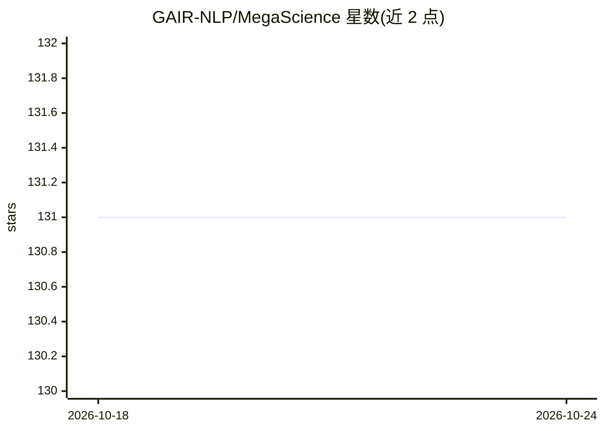

# GAIR-NLP/MegaScience

⭐ 131 · Python · Apache-2.0 · 推送 2026-07-09 · [GitHub](https://github.com/GAIR-NLP/MegaScience) · [官网](https://huggingface.co/MegaScience) · 组织维护

**科学推理后训练数据集及配套模型、数据构建与评测系统**

COLM 2026 论文的配套开源项目：发布 TextbookReasoning（12k 大学理科教材抽取的 65 万条推理问答）与 MegaScience（125 万条混合数据集），并开源 9 个基于 Qwen2/3 与 Llama3.1 训练的模型检查点。仓库同时提供完整数据构建流水线（PDF 数字化、QA 抽取、去重、CoT 蒸馏、基于嵌入检索与 LLM 判断的基准去污染）与 15 个基准的评测系统。微调依赖 LLaMA-Factory，推理环节使用 vLLM。数据集采用 CC-BY-NC-NC-SA 类非商业许可（CC-BY-NC-SA-4.0），模型多为 apache-2.0。

## 筛选速览

| 维度 | 判定 | 备注 |
|---|---|---|
| AI 角色 | `ai-knowledge` | 知识聚合/清单类 |
| 许可风险 | `permissive` | Apache-2.0 |
| 部署形态 | `library` | 以包/库形式分发 |
| 模型依赖 | local-ok | 支持本地模型 |
| 硬件要求 | — | 无带数字的原话,不猜 |
| 安装摩擦 | `low` | 无编译、无系统依赖或容器化 |
| 成熟度 | — | 结构信号不足 |

## 能力要点

- TextbookReasoning：65 万条来自 12k 教材的 7 学科推理问答
- MegaScience：125 万条经系统消融筛选的混合数据集
- 开源 9 个 Qwen2/3 与 Llama3.1 后训练模型检查点
- 完整数据构建流水线：抽取/去重/CoT 蒸馏/LLM 去污染

## 适用场景

- 下载科学推理后训练数据集微调自己的模型
- 复用数据构建流水线从教材 PDF 制作问答数据
- 在 15 个科学基准上评测科学推理能力

## 场景标签

`模型评测` `文档解析` · 领域:评测与运维

## 证据(README 行号)

> L17: |**TextbookReasoning**|🤗 MegaScience/TextbookReasoning|0.65 million|CC-BY-NC-SA-4.0|
> L18: |**MegaScience**|🤗 MegaScience/MegaScience|1.25 million|CC-BY-NC-SA-4.0|
> L34: To develop AI scientists and support human researchers in advancing the frontiers of natural science discovery, we 

## 星数曲线

2026-10-18 131 → 2026-10-24 131（+0）

---
*卡片 v1 · prompt 1.4 · 生成 2026-10-23 · 置信度 high · 依据 README sha `469c8eb70e9c` · [字段定义](../../DATASET.md)*
