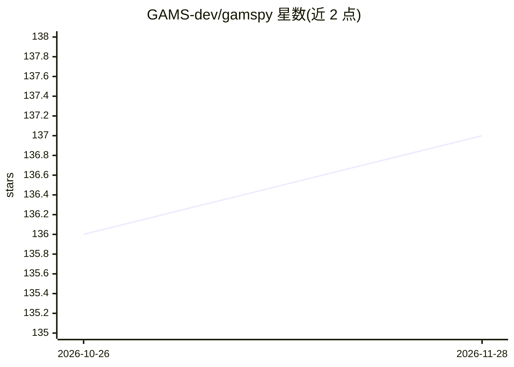

# GAMS-dev/gamspy

⭐ 137 · Python · NOASSERTION · 推送 2026-11-27 · [GitHub](https://github.com/GAMS-dev/gamspy) · [官网](https://gamspy.readthedocs.io) · 组织维护

**用 Python 书写数学优化模型的建模库**

GAMSPy 是 Python 数学优化建模库，以接近数学表达的方式声明变量与约束，由 GAMS 执行引擎在 Python 外部生成模型，模型规模不受 Python 循环速度限制。支持 LP、MIP、NLP、MINLP、QCP、MCP 模型类型，可通过 `gamspy install solver` 安装 HiGHS、Gurobi、Knitro、Xpress、BARON、MOSEK 等求解器并可替换求解器而不改动模型。数据可从 NumPy 数组或 pandas DataFrame 读入并回传。随安装附带 GAMS 运行时、默认求解器与 demo 许可，本地、GAMS Engine 或 NEOS Server 上均可运行。

## 筛选速览

| 维度 | 判定 | 备注 |
|---|---|---|
| AI 角色 | `ai-enhanced` | 去掉 AI 部分产品仍成立 |
| 许可风险 | `permissive` | NOASSERTION |
| 部署形态 | `library` | 以包/库形式分发 |
| 模型依赖 | — | README 未给出锁定关系 |
| 硬件要求 | — | 无带数字的原话,不猜 |
| 安装摩擦 | `low` | 无编译、无系统依赖或容器化 |
| 成熟度 | — | 结构信号不足 |

## 能力要点

- 集合上的索引代数建模，模型生成由 GAMS 执行引擎在 Python 外完成
- 可切换 CPLEX、CONOPT、PATH 及 HiGHS、Gurobi 等多种求解器
- 可将 PyTorch 网络与决策树、随机森林、梯度提升模型嵌入为约束
- 随 pip 安装附带 GAMS 运行时、默认求解器与 demo 许可

## 适用场景

- 写电池套利、调度等线性/非线性优化模型
- 把训练好的 ML 模型作为约束嵌入优化问题
- 同一模型在不同求解器间切换求解
- 构建随机规划（SDDP，beta）与分段线性建模

## 场景标签

 · 领域:运筹学/优化建模

## 证据(README 行号)

> L18: - **Model generation outside Python.** GAMSPy hands the algebra to the GAMS execution engine, which has generated l
> L21: - **Machine learning inside optimization.** Embed trained PyTorch networks and decision trees, random forests and g

## 星数曲线

2026-10-26 136 → 2026-11-28 137（+1）

---
*卡片 v1 · prompt 1.4 · 生成 2026-11-28 · 置信度 mid · 依据 README sha `0c1c507df401` · [字段定义](../../DATASET.md)*
