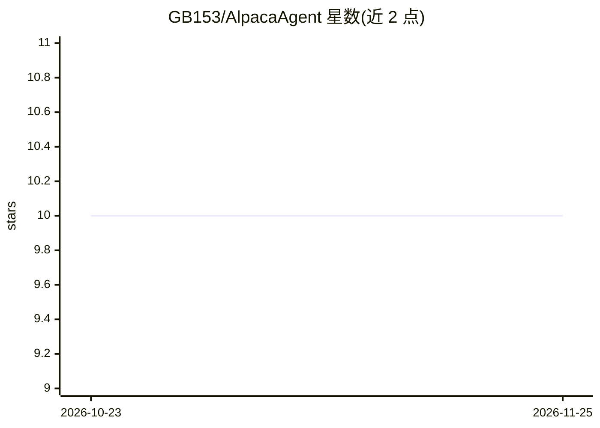

# GB153/AlpacaAgent

⭐ 10 · Python · 推送 2025-12-12 · [GitHub](https://github.com/GB153/AlpacaAgent) · 个人维护

**面向个人的模型无关加密货币交易 agent 模板**

一个精简的模板工程，用于构建加密货币研究与交易助手：通过 Tavily 检索新闻与行情上下文，接入 Alpaca 模拟盘交易（账户、资产、持仓、订单），由 PydanticAI 强制结构化输出（如 buy/sell/hold + 置信度）与工具调用，并用状态文件在下单后做对账。作者定位为实验性项目，模型可在 main.py 中更换，凡 PydanticAI 支持的模型均可使用；README 明确说明仅支持模拟盘（paper trading）。

## 筛选速览

| 维度 | 判定 | 备注 |
|---|---|---|
| AI 角色 | `ai-native` | 本体是模型或模型工具 |
| 许可风险 | `none` | — |
| 部署形态 | `self-host` | docker 或自建部署 |
| 模型依赖 | — | README 未给出锁定关系 |
| 硬件要求 | — | 无带数字的原话,不猜 |
| 安装摩擦 | `low` | 无编译、无系统依赖或容器化 |
| 成熟度 | — | 结构信号不足 |

## 能力要点

- PydanticAI 结构化输出与工具调用（buy/sell/hold + confidence）
- Tavily 搜索提供新闻/行情上下文
- Alpaca paper trading 下单与状态文件对账
- 模型无关：PydanticAI 支持的模型均可接入

## 适用场景

- 在模拟盘上实验 agent 自主决策的交易流程
- 作为加密货币研究助手的二次开发模板

## 场景标签

`金融量化` · 领域:学习与行业

## 证据(README 行号)

> L3: A small, opinionated template for building an “agentic” crypto research + trading assistant:
> L7: - **PydanticAI**: enforces structured outputs (e.g., buy/sell/hold + confidence) and tool calling

## 星数曲线

2026-10-23 10 → 2026-11-25 10（+0）

---
*卡片 v1 · prompt 1.4 · 生成 2026-11-20 · 置信度 high · 依据 README sha `aa4ea338cd91` · [字段定义](../../DATASET.md)*
