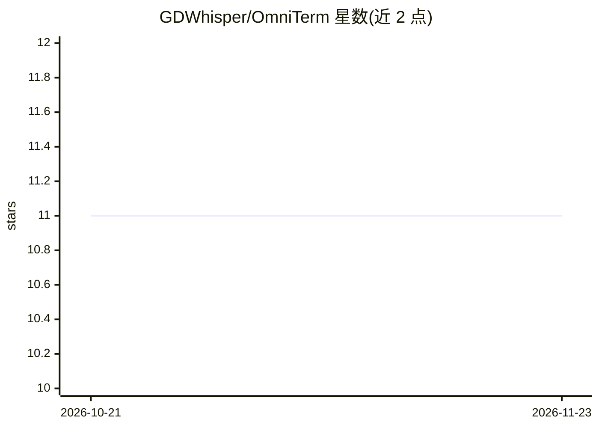

# GDWhisper/OmniTerm

⭐ 11 · TypeScript · NOASSERTION · 推送 2026-10-29 · [GitHub](https://github.com/GDWhisper/OmniTerm) · [官网](https://github.com/GDWhisper/OmniTerm) · 个人维护 · 中文 README

**多 AI 编码智能体的统一 Web 监控与操作界面**

自托管 Web 应用，将多个同时运行的 AI 编码智能体（Claude Code、Codex、Gemini、OpenCode、Qwen Code、Kiro 等）聚合到单个浏览器页面：每个 agent 一张实时状态卡片，通过 ACP 协议以聊天方式驱动 agent，回复渲染为文本、工具调用卡片与可折叠思考；工具审批、模型切换可在会话中途完成，等待输入时触发标签页闪烁、声音与侧边栏提醒。内置 xterm.js 终端与文件浏览器，支持移动端软键盘；空闲会话自动回收，会话可一键释放并保留日志。后端 Rust + Axum + SQLite 单二进制部署，前端 React 19。

## 筛选速览

| 维度 | 判定 | 备注 |
|---|---|---|
| AI 角色 | `ai-ecosystem` | LLM/agent 周边工具 |
| 许可风险 | `none` | NOASSERTION |
| 部署形态 | `self-host` | docker 或自建部署 |
| 模型依赖 | — | README 未给出锁定关系 |
| 硬件要求 | — | 无带数字的原话,不猜 |
| 安装摩擦 | `low` | 无编译、无系统依赖或容器化 |
| 成熟度 | — | 结构信号不足 |

## 能力要点

- 多 agent 实时状态卡片：运行中/等待输入/已完成
- 通过 ACP 协议以聊天界面驱动 agent，支持工具审批与中途模型切换
- 内置 xterm.js 终端与文件浏览器，支持移动端
- Rust 后端 + 内嵌前端 + SQLite 的单二进制部署

## 适用场景

- 同时运行多个 AI 编码 agent 时在单个页面监控全部状态
- agent 等待确认时通过声音与标签提醒及时介入
- 通过手机浏览器远程查看和操作 agent 会话

## 场景标签

 · 领域:开发者工具/AI agent 管理

## 证据(README 行号)

> L27: **OmniTerm pulls them all into a single browser tab.** Each agent gets a card that tells you what it's doing in rea
> L33: **Drive agents like a chat** — pick an agent and just talk (over the ACP protocol): its replies become clean text, 

## 星数曲线

2026-10-21 11 → 2026-11-23 11（+0）

---
*卡片 v1 · prompt 1.4 · 生成 2026-11-19 · 置信度 high · 依据 README sha `4f9327ae2550` · [字段定义](../../DATASET.md)*
