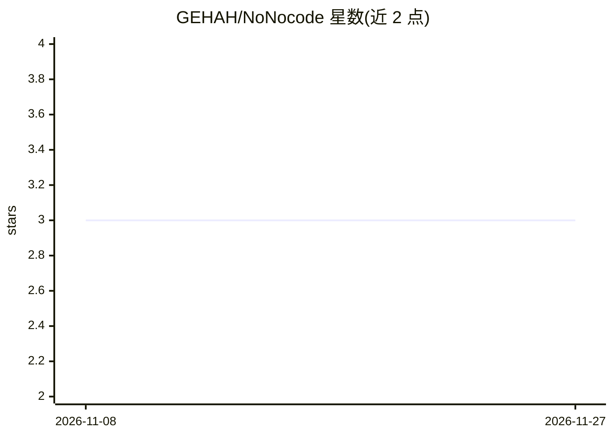

# GEHAH/NoNocode

⭐ 3 · Python · 推送 2026-10-29 · [GitHub](https://github.com/GEHAH/NoNocode) · 个人维护 · 中文 README

**带持久记忆与可验证规则进化的终端个人 AI 助手**

跑在终端里的个人 AI 助手，把日常对话沉淀为长期记忆和经审核的工作规则。内置文件读写、Grep、Bash、联网搜索抓取等工具，支持子代理、团队协作、技能包与 MCP 工具延迟加载。能力类改进主张须在冻结输入和固定检查任务上对照试跑通过才可采纳，不训练模型权重。默认只放行读取，写文件与执行命令需确认，提供路径限制、Git worktree 隔离和可选 OS 沙箱。需 Python 3.11+，从源码 pip 安装。

## 筛选速览

| 维度 | 判定 | 备注 |
|---|---|---|
| AI 角色 | `ai-native` | 本体是模型或模型工具 |
| 许可风险 | `none` | — |
| 部署形态 | `library` | 以包/库形式分发 |
| 模型依赖 | — | README 未给出锁定关系 |
| 硬件要求 | — | 无带数字的原话,不猜 |
| 安装摩擦 | `low` | 无编译、无系统依赖或容器化 |
| 成熟度 | — | 结构信号不足 |

## 能力要点

- 自动记忆与进化账本分开存放，能力候选须经对照验证后才能采纳
- 内置 ReadFile/WriteFile/Bash/WebSearch 等工具，支持子代理与团队协作
- 默认只读权限，写操作与命令执行需确认，支持沙箱与 worktree 隔离
- 终端 TUI、单次执行与浏览器界面三种入口

## 适用场景

- 在终端里让 AI 代为写代码、整理文件并保留工作习惯
- 让工作规则改动经过固定任务对照验证后再生效
- 跨项目沉淀用户偏好与项目事实记忆

## 场景标签

`Agent 记忆` `AI 助手` · 领域:Agent 开发

## 证据(README 行号)

> L3:  跑在终端里的个人 AI 助手。
> L12: NoNocode 把日常对话沉淀成两类可以复查的东西：长期记忆，以及经过你审核的工作规则。表达偏好由你决定是否采纳；涉及方法或效果的能力主张，必须先在固定任务上跑过对照检查，才会进入后续对话。改进记在规则和记忆里，不训练模型权重，

## 星数曲线

2026-11-08 3 → 2026-11-27 3（+0）

---
*卡片 v1 · prompt 1.4 · 生成 2026-11-22 · 置信度 high · 依据 README sha `719dbf678aa0` · [字段定义](../../DATASET.md)*
