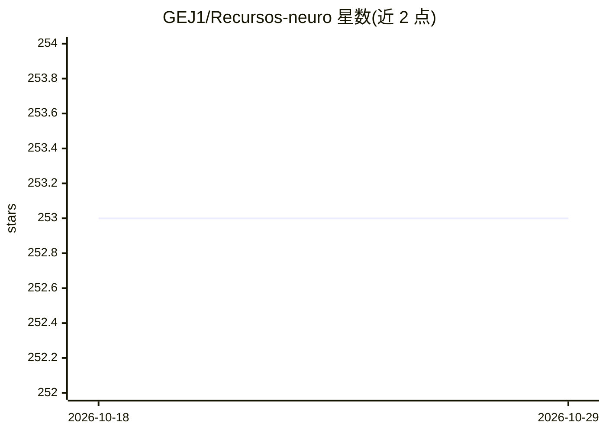

# GEJ1/Recursos-neuro

⭐ 253 · MIT · 推送 2026-03-23 · [GitHub](https://github.com/GEJ1/Recursos-neuro) · 个人维护

**认知/计算神经科学免费学习资源清单（西英双语）**

个人维护的神经科学学习资源聚合仓库，按 EEG、fMRI、眼动追踪、计算神经科学、神经解剖、实验工具、数学/统计工具、认知科学与机器学习等主题组织，收录课程、视频、教程、书籍与代码库。内容限定免费资源，覆盖西班牙语与英语课程（含布宜诺斯艾利斯大学、斯坦福、NYU、MIT 等来源）。通过 pull request 接受新条目，本身不含代码，无需安装运行。

## 筛选速览

| 维度 | 判定 | 备注 |
|---|---|---|
| AI 角色 | `ai-knowledge` | 知识聚合/清单类 |
| 许可风险 | `permissive` | MIT |
| 部署形态 | `None` |  |
| 模型依赖 | — | README 未给出锁定关系 |
| 硬件要求 | — | 无带数字的原话,不猜 |
| 安装摩擦 | `low` | 无编译、无系统依赖或容器化 |
| 成熟度 | — | 结构信号不足 |

## 能力要点

- 按 EEG/fMRI/眼动/计算神经科学等多主题组织条目
- 仅收录免费内容，覆盖西英双语课程
- 数学统计与机器学习工具单独成章
- 通过 pull request 社区共建

## 适用场景

- 系统查找神经科学各子领域的学习课程与教程
- 寻找配套的 Python 数据分析工具教学（MNE、PsychoPy、jsPsych 等）
- 西班牙语使用者寻找母语神经科学课程资源

## 场景标签

`精选清单` · 领域:学习与行业

## 证据(README 行号)

> L3: Repo para ir agregando recursos en Neurociencia Cognitva, computacional y temas relacionados (estadística, métodos d
> L11: ## Temas

## 星数曲线

2026-10-18 253 → 2026-10-29 253（+0）

---
*卡片 v1 · prompt 1.4 · 生成 2026-10-22 · 置信度 high · 依据 README sha `f1f3a7fa8752` · [字段定义](../../DATASET.md)*
