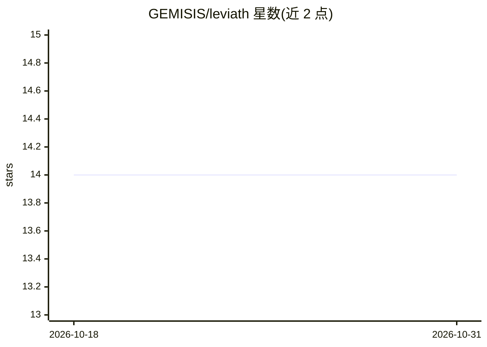

# GEMISIS/leviath

⭐ 14 · Rust · MIT · 推送 2026-10-30 · [GitHub](https://github.com/GEMISIS/leviath) · [官网](https://leviath.dev) · 个人维护

**Rust 单二进制的结构化 AI agent 运行时，供开发者运行编排 agent**

面向开发者的 LLM agent 运行时：以 TOML 蓝图定义 agent，窗口按命名区域切分并设定丢弃优先级，任务分多阶段有向图执行，每阶段可配置独立模型与工具；基于 bevy_ecs 在单进程托管大量 agent，后台 daemon 支持开机自启与断点恢复。附带 11 个内置 agent、TUI 仪表盘、REST+WebSocket API、OpenTelemetry 观测与 Agent Client Protocol。shell 默认在本机执行，容器沙箱为可选。限制：单机单进程部署、不支持按次临时沙箱、需自备模型 provider。

## 筛选速览

| 维度 | 判定 | 备注 |
|---|---|---|
| AI 角色 | `ai-ecosystem` | LLM/agent 周边工具 |
| 许可风险 | `permissive` | MIT |
| 部署形态 | `library` | 以包/库形式分发 |
| 模型依赖 | local-ok | 支持本地模型 |
| 硬件要求 | — | 无带数字的原话,不猜 |
| 安装摩擦 | `low` | 无编译、无系统依赖或容器化 |
| 成熟度 | — | 结构信号不足 |

## 能力要点

- 结构化上下文区域与百分比预算，防止文件读取挤出系统提示
- 多阶段有向图工作流：阶段级模型/工具/上下文布局、stuck 检测与回退
- bevy_ecs 单进程托管数千 agent，共享推理池限流
- lev serve 提供 REST+WebSocket API；支持 MCP 工具服务器与 ACP 编辑器接入

## 适用场景

- 在本地或服务器上运行与编排多个编码、研究、日志分析 agent
- 为不同任务阶段配置不同模型与工具以控制成本
- 通过 REST API 或编辑器（ACP）以无头方式驱动 agent

## 场景标签

`Agent 框架` `多智能体` · 领域:Agent 开发

## 证据(README 行号)

> L10: **Light.** Thousands of agents in one bevy_ecs process, from a single binary. No Node, Python, or Docker.
> L219: Leviath is a runtime that agents run *on*. Claude Code, Codex, and OpenHands are agents you work

## 星数曲线

2026-10-18 14 → 2026-10-31 14（+0）

---
*卡片 v1 · prompt 1.4 · 生成 2026-10-31 · 置信度 high · 依据 README sha `6dc307ee939a` · [字段定义](../../DATASET.md)*
