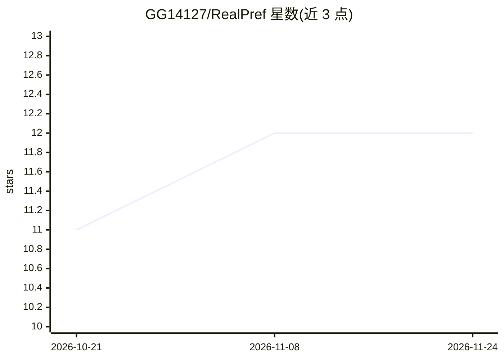

# GG14127/RealPref

⭐ 12 · Python · 推送 2026-03-13 · [GitHub](https://github.com/GG14127/RealPref) · 个人维护

**评测 LLM 长程偏好跟随能力的个性化基准数据集**

随论文发布的基准，包含数据与脚本两部分：数据为用户画像、生活事件传记、从显式到隐式的偏好表达对话、QA 测试集，种子 persona 取自 PersonaHub；脚本覆盖数据生成、测试、评判三个阶段，支持 zero_shot/reminder/cot/rag 四种测试方法，开放题用 LLM-as-a-Judge 按评分细则打分，并通过 context_config 控制上下文长度（2K 至 247K token）。面向研究个性化对话的评测者，代码主要配合 API 型 LLM 使用。

## 筛选速览

| 维度 | 判定 | 备注 |
|---|---|---|
| AI 角色 | `ai-ecosystem` | LLM/agent 周边工具 |
| 许可风险 | `none` | — |
| 部署形态 | `None` |  |
| 模型依赖 | — | README 未给出锁定关系 |
| 硬件要求 | — | 无带数字的原话,不猜 |
| 安装摩擦 | `low` | 无编译、无系统依赖或容器化 |
| 成熟度 | — | 结构信号不足 |

## 能力要点

- 长程对话数据集：显式到隐式四级偏好表达与泛化偏好场景
- 多面评测协议：选择题、判断题、开放题加评分细则
- 六档上下文配置（2K–247K token）控制历史长度
- 生成、测试、评判三段式脚本管线

## 适用场景

- 测试模型在长对话历史中记住并遵循用户偏好的能力
- 比较不同测试方法（zero-shot/CoT/RAG）在偏好任务上的表现
- 基于其数据自行构建个性化评测流程

## 场景标签

`模型评测` · 领域:评测与运维

## 证据(README 行号)

> L1: # RealPref Benchmark
> L19: - **Evaluation Framework**: a multi-faceted evaluation protocol consisting of multiple-choice, true-or-false, and o
> L184: Our code is generally working with API based LLM. If you also want to use API based LLM (e.g., openai api or openr

## 星数曲线

2026-10-21 11 → 2026-11-24 12（+1）

---
*卡片 v1 · prompt 1.4 · 生成 2026-11-18 · 置信度 high · 依据 README sha `4b1dd84c334f` · [字段定义](../../DATASET.md)*
