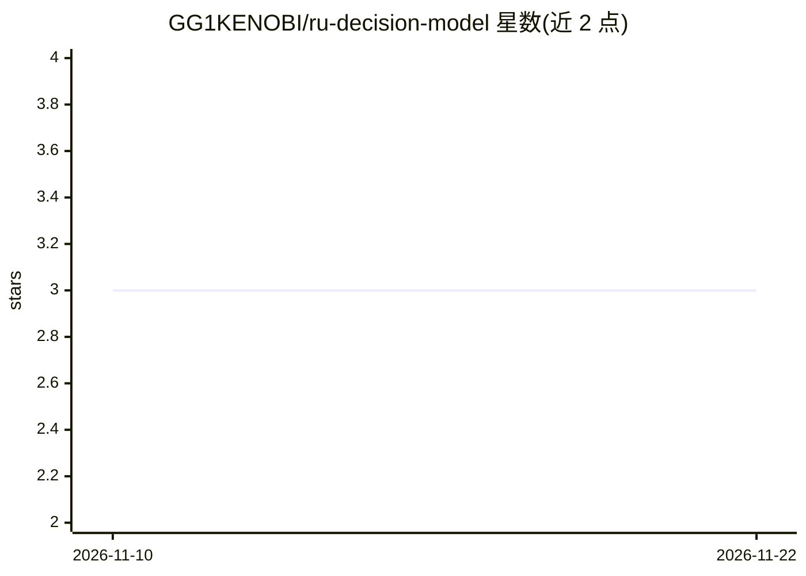

# GG1KENOBI/ru-decision-model

⭐ — · [GitHub]() · 组织维护

**俄语决策模型全流程包：数据、LoRA 训练、评估与教程**

围绕开源模型 6E6E/ru-decision-4b 的完整工程包：构建 100,112 条俄语训练任务（11 个公开俄语数据集、26 类代码生成的合成规程、按 tev1 配方的英语部分），在单张显卡上对 Qwen3.5-4B 做 LoRA 训练，输出每个选项的概率分布。内置训练/测试泄露哈希检查、温度校准与 ECE、自动化比例与置信错误指标，并与多个模型在统一校准下对比。附教程覆盖数据组装到评估全步骤，含租金约 350–500 卢布/次的成本记录。

## 筛选速览

| 维度 | 判定 | 备注 |
|---|---|---|
| AI 角色 | `ai-native` | 本体是模型或模型工具 |
| 许可风险 | `permissive` | — |
| 部署形态 | `library` | 以包/库形式分发 |
| 模型依赖 | — | README 未给出锁定关系 |
| 硬件要求 | — | 无带数字的原话,不猜 |
| 安装摩擦 | `medium` | 含编译或系统依赖之一 |
| 成熟度 | — | 结构信号不足 |

## 能力要点

- 单卡 LoRA 训练 Qwen3.5-4B，峰值显存 20.9 GB
- 100,112 条训练任务，含代码生成、标注恒真的合成规程
- 内置数据泄露检查、温度校准（ECE）与自动化比例指标
- 统一校准条件下与多个模型的对比脚本

## 适用场景

- 为审批/路由类业务规则训练俄语决策模型
- 按置信度阈值把决策自动分流给模型或人工
- 在自有规程标注上复现并评估该训练流程

## 场景标签

`教程课程` `微调` `模型评测` · 领域:评测与运维

## 证据(README 行号)

> L7: Код, данные и туториал к модели **6E6E/ru-decision-4b** — открытой «модели решений» для русского языка.
> L13: **Что в репозитории:** сборка 100 тыс. обучающих задач (открытые русские наборы + синтетические регламенты с размет
> L98: - база **Qwen/Qwen3.5-4B**, LoRA r16, alpha 32, все линейные слои;

## 星数曲线

2026-11-10 3 → 2026-11-22 3（+0）

---
*卡片 v1 · prompt 1.4 · 生成 2026-11-22 · 置信度 high · 依据 README sha `2e96a63f2ef8` · [字段定义](../../DATASET.md)*
