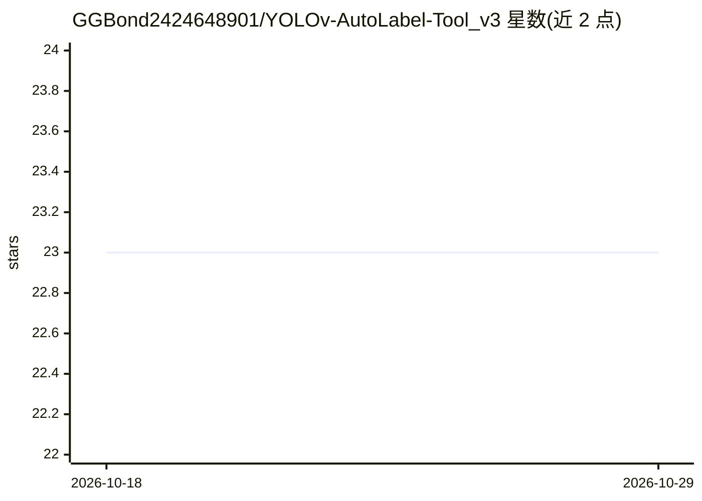

# GGBond2424648901/YOLOv-AutoLabel-Tool_v3

⭐ 23 · HTML · CC0-1.0 · 推送 2026-01-03 · [GitHub](https://github.com/GGBond2424648901/YOLOv-AutoLabel-Tool_v3) · 个人维护 · 中文 README

**网页端 YOLO 自动标注工具：加载自训模型标注图片视频并导出训练格式**

基于 Python/Flask 的网页端标注工具：用户上传 .pt 格式的 YOLOv5/YOLOv8 模型（官方或自训），对图片与视频帧批量执行检测并生成分割/检测标注，也可拖拽手动绘制与编辑边界框。可调节置信度、IoU 阈值与输入尺寸，标注结果导出为 YOLO JSON、COCO JSON、YOLO TXT、Pascal VOC 四种格式，并带 REST API。GPU 为可选，CPU 亦可运行。

## 筛选速览

| 维度 | 判定 | 备注 |
|---|---|---|
| AI 角色 | `ai-native` | 本体是模型或模型工具 |
| 许可风险 | `viral` | CC0-1.0 |
| 部署形态 | `library` | 以包/库形式分发 |
| 模型依赖 | — | README 未给出锁定关系 |
| 硬件要求 | — | 无带数字的原话,不猜 |
| 安装摩擦 | `medium` | 含编译或系统依赖之一 |
| 成熟度 | — | 结构信号不足 |

## 能力要点

- 加载 YOLOv5/YOLOv8 自定义 .pt 模型自动标注图片与视频帧
- 导出 YOLO JSON / COCO JSON / YOLO TXT / Pascal VOC 四种训练格式
- 置信度、IoU 阈值与输入尺寸可调，支持批量静默处理
- 提供 RESTful API（上传模型/媒体、单张与批量预测、导出）

## 适用场景

- 用已训练的 YOLO 模型给图片或视频批量预标注，再做人工修正
- 将标注结果导出为 COCO 或 YOLO 格式用于后续训练
- 通过 API 将预测能力接入自己的流程

## 场景标签

`目标检测` · 领域:感知与多模态

## 证据(README 行号)

> L3: 一个功能强大的网页端YOLOv自动标注工具，支持加载自定义训练模型，自动标注图片和视频，并导出为多种训练格式。
> L11: - 🧠 **支持多种YOLO模型**: YOLOv5、YOLOv8等预训练模型
> L12: - 🖼️ **智能图像标注**: 自动识别和标注图片中的目标

## 星数曲线

2026-10-18 23 → 2026-10-29 23（+0）

---
*卡片 v1 · prompt 1.4 · 生成 2026-10-27 · 置信度 mid · 依据 README sha `a75884499eec` · [字段定义](../../DATASET.md)*
