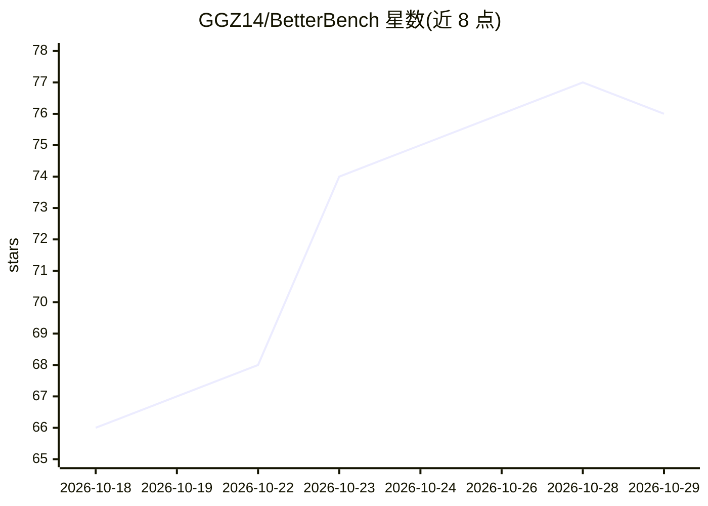

# GGZ14/BetterBench

⭐ 76 · Python · NOASSERTION · 推送 2026-10-09 · [GitHub](https://github.com/GGZ14/BetterBench) · [官网](https://discord.gg/launch80) · 个人维护

**面向 LLM 推理服务的百分位基准测试工具，支持 1% 级 A/B 判定**

针对任意 OpenAI 兼容 /v1 端点（vLLM、llama.cpp server、SGLang、TGI、Ollama、LM Studio 等）的基准测试 CLI。以真实任务类别（散文、推理、数学、代码、JSON、文件编辑、摘要、对话）测量 TTFT、token 间延迟与吞吐的分布（1% low/中位/均值/99% high），通过成对漂移消除的 A/B 测量判定约 1% 量级差异，95% 置信区间内拒绝在噪声带内宣布胜者。每次运行生成自包含离线 HTML 报告。pip 安装，仅需 Python 3.10+、标准库与 numpy。

## 筛选速览

| 维度 | 判定 | 备注 |
|---|---|---|
| AI 角色 | `ai-ecosystem` | LLM/agent 周边工具 |
| 许可风险 | `none` | NOASSERTION |
| 部署形态 | `library` | 以包/库形式分发 |
| 模型依赖 | local-ok | 支持本地模型 |
| 硬件要求 | — | 无带数字的原话,不猜 |
| 安装摩擦 | `low` | 无编译、无系统依赖或容器化 |
| 成熟度 | — | 结构信号不足 |

## 能力要点

- TTFT/ITL/吞吐的百分位分布报告，非单一均值
- 成对 A/B 测量，95% CI 且拒绝噪声带内的胜者判定
- prefill 深度扫描（2K→64K）与并发扫描定位吞吐/延迟拐点
- 单文件离线 HTML 报告，无外部网络资源

## 适用场景

- 对比两套推理服务或两个版本的端到端性能差异
- 测量不同并发级别下服务的吞吐/延迟拐点
- 生成长上下文/RAG 场景下的 prefill 吞吐报告

## 场景标签

`模型评测` · 领域:评测与运维

## 证据(README 行号)

> L3: A real-world, percentile-based benchmark for LLM inference servers. Point it at any
> L4: **OpenAI-compatible `/v1` endpoint** (vLLM, llama.cpp server, SGLang, TGI, Ollama, LM Studio, …)
> L29: pip install -e .          # editable install works out of the box; needs Python 3.10+, stdlib + numpy only

## 星数曲线

2026-10-18 66 → 2026-10-29 76（+10）

---
*卡片 v1 · prompt 1.4 · 生成 2026-10-24 · 置信度 high · 依据 README sha `65040631ac59` · [字段定义](../../DATASET.md)*
