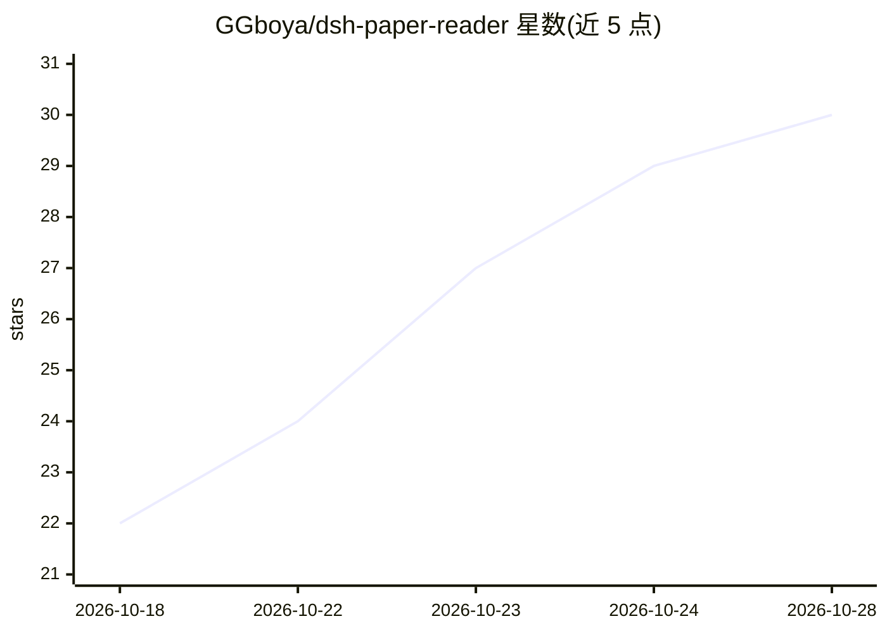

# GGboya/dsh-paper-reader

⭐ 30 · JavaScript · MIT · 推送 2026-10-22 · [GitHub](https://github.com/GGboya/dsh-paper-reader) · 个人维护 · 中文 README

**DeepSeek Harness 插件：论文伴读工作台，PDF 阅读 + 带页码 AI 问答**

面向 DeepSeek Harness (dsh) 的插件，提供专题文献库 + PDF 阅读器 + 对话三栏工作台：回答自带页码、点页码跳回原文高亮，选中文字即问。支持教练式带读（AI 点评追问、跨会话进度）、babeldoc 驱动的中译 PDF 导出（中英对照/分屏）、划词翻译（MinerU LaTeX 公式保留）。可选 MinerU 解析扫描件与嵌入端点。普通用户经官方桌面端插件市场安装，开发者用 dsh 命令行安装；要求官方桌面端 V0.2.0-rc.2+。删除文献进回收站可恢复，带路径穿越拒绝与回滚机制。

## 筛选速览

| 维度 | 判定 | 备注 |
|---|---|---|
| AI 角色 | `ai-native` | 本体是模型或模型工具 |
| 许可风险 | `permissive` | MIT |
| 部署形态 | `library` | 以包/库形式分发 |
| 模型依赖 | locked-api |  |
| 硬件要求 | — | 无带数字的原话,不猜 |
| 安装摩擦 | `low` | 无编译、无系统依赖或容器化 |
| 成熟度 | — | 结构信号不足 |

## 能力要点

- 回答必带页码，点页码跳回 PDF 原文并高亮
- 教练式带读 preset：分步计划 + AI 点评追问，学习进度跨会话累积
- babeldoc 驱动中文翻译：长段落不截断、实时进度、译文 PDF 一键导出
- 文献删除进回收站可恢复，路径穿越拒绝、失败自动回滚

## 适用场景

- 读论文时向 AI 提问并按页码回到原文核对
- 把英文论文一键转纯中文或中英对照 PDF
- 按专题管理文献库并保留对话历史
- 通过教练式带读按计划精读论文

## 场景标签

`科研工具` `文档问答` · 领域:知识与检索

## 证据(README 行号)

> L10: DeepSeek Harness (dsh) 插件：**论文伴读工作台** —— 文献库 + PDF 阅读器 + AI 伴读，回答自带页码、点页码跳回原文。当前版本 **v1.6.0**。
> L23: - 💬 **带页码的伴读**：回答必带页码，点页码跳回原文并高亮；选中文字即问；支持历史对话
> L24: - 🤖 **可选教练式带读**：专用 preset 制定分步计划；你读原文、作答，AI 点评追问，当前阶段答好才继续，学习进度跨会话累积

## 星数曲线

2026-10-18 22 → 2026-10-28 30（+8）

---
*卡片 v1 · prompt 1.4 · 生成 2026-10-26 · 置信度 high · 依据 README sha `865100873a57` · [字段定义](../../DATASET.md)*
