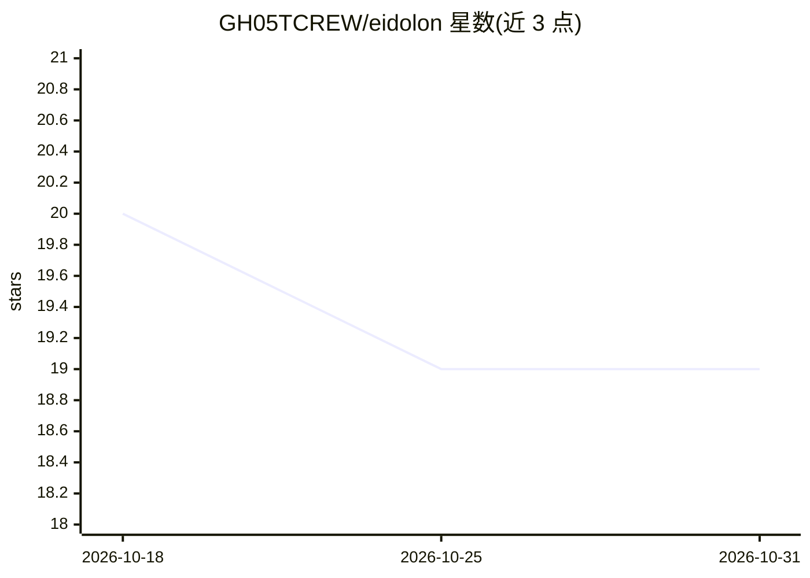

# GH05TCREW/eidolon

⭐ 19 · Python · MIT · 推送 2026-02-06 · [GitHub](https://github.com/GH05TCREW/eidolon) · 个人维护

**把网络扫描结果存入 Neo4j 图库并用自然语言操作的安全工具**

网络安全工具：用 nmap 自动扫描主机、端口与服务，将资产与连接关系存入 Neo4j 图数据库；用户可用自然语言提问（如从互联网到某数据库的路径），LLM 将意图（如隔离某主机）翻译为可执行计划，经审批后由沙箱化工具（终端、浏览器、文件编辑）执行，全过程记录到 Postgres 审计。提供 React 前端做图可视化、对话与审批。需预装 nmap，通过脚本一键启动全部服务。

## 筛选速览

| 维度 | 判定 | 备注 |
|---|---|---|
| AI 角色 | `ai-enhanced` | 去掉 AI 部分产品仍成立 |
| 许可风险 | `permissive` | MIT |
| 部署形态 | `None` |  |
| 模型依赖 | — | README 未给出锁定关系 |
| 硬件要求 | — | 无带数字的原话,不猜 |
| 安装摩擦 | `low` | 无编译、无系统依赖或容器化 |
| 成熟度 | — | 结构信号不足 |

## 能力要点

- nmap 扫描结果自动构建 Neo4j 资产与连接关系图
- 自然语言查询基础设施（如互联网到数据库的路径）
- LLM 生成执行计划，沙箱工具带权限控制与审批流程
- 扫描、查询、计划、执行全量写入 Postgres 审计日志

## 适用场景

- 我想用一句话查询内网中从外部可达数据库的路径
- 扫描后用自然语言下发隔离主机等安全操作并留审计记录
- 以图可视化方式查看资产与网络连接关系

## 场景标签

`网络安全` · 领域:学习与行业

## 证据(README 行号)

> L3: Network scanner with AI-powered analysis and automation. Scans your infrastructure with nmap, stores it in a graph d
> L12: - **Plan generation**: LLM translates intents like "isolate host X" into executable steps

## 星数曲线

2026-10-18 20 → 2026-10-31 19（-1）

---
*卡片 v1 · prompt 1.4 · 生成 2026-10-29 · 置信度 mid · 依据 README sha `c2f48c93744f` · [字段定义](../../DATASET.md)*
