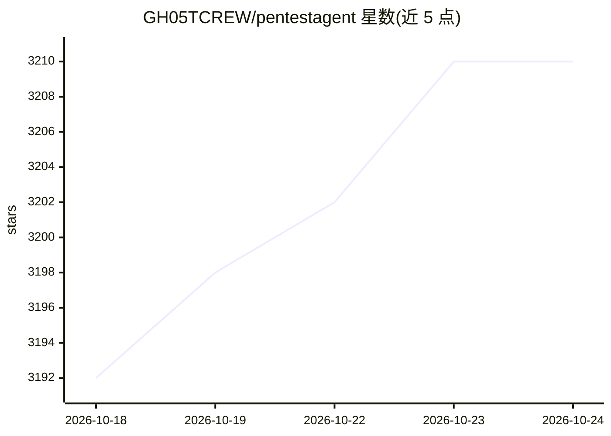

# GH05TCREW/pentestagent

⭐ 3,210 · Python · MIT · 推送 2026-10-12 · [GitHub](https://github.com/GH05TCREW/pentestagent) · 个人维护

**面向黑盒安全测试的 AI 渗透测试代理（TUI/CLI）**

基于 LLM 的渗透测试 AI 代理：通过 TUI 提供 Assist/Agent/Crew/Interact 四种模式，可自主执行侦察与测试任务，内置 terminal、browser、notes、web_search 等工具。支持 LiteLLM 兼容的多家模型（OpenAI/Anthropic 或自定义中转端点），可通过 Docker 隔离运行 nmap、msfconsole、sqlmap 等工具。支持 MCP 双向集成：既可接入外部 MCP 服务器，也可自身作为 MCP 服务器被 Claude Desktop、Cursor 等客户端调用；提供子代理自派生（spawn_mcp_agent）与大规模工具目录的 RAG 优化器（超过 128 工具时以嵌入检索替代全量注入）。

## 筛选速览

| 维度 | 判定 | 备注 |
|---|---|---|
| AI 角色 | `ai-native` | 本体是模型或模型工具 |
| 许可风险 | `permissive` | MIT |
| 部署形态 | `self-host` | docker 或自建部署 |
| 模型依赖 | locked-api |  |
| 硬件要求 | — | 无带数字的原话,不猜 |
| 安装摩擦 | `low` | 无编译、无系统依赖或容器化 |
| 成熟度 | — | 结构信号不足 |

## 能力要点

- Assist/Agent/Crew/Interact 四种运行模式与预置攻击 playbook
- spawn_mcp_agent 子代理自派生，支持多代理分层委派
- MCP 双向集成：客户端模式消费外部服务器，服务器模式经 stdio/SSE 暴露自身
- MCP 工具目录超过 128 个时自动启用嵌入检索式 RAG 优化器
- Docker 隔离运行内置渗透工具（nmap/msfconsole/sqlmap 等）

## 适用场景

- 授权渗透测试与红队场景下让代理自主执行侦察和测试任务
- 漏洞赏金（bug bounty）流程中按 playbook 执行结构化安全评估
- 通过 Claude Desktop / Cursor 等 MCP 客户端远程驱动渗透测试任务
- 并行派生多个子代理对不同网段执行分布式侦察

## 场景标签

`网络安全` · 领域:学习与行业

## 证据(README 行号)

> L4: ### AI Penetration Testing
> L97: |Assist|`/assist <task>`|One single-shot instruction, with tool execution|
> L98: |Agent|`/agent <task>`|Autonomous execution of a single task|

## 星数曲线

2026-10-18 3,192 → 2026-10-24 3,210（+18）

---
*卡片 v1 · prompt 1.4 · 生成 2026-10-20 · 置信度 mid · 依据 README sha `899b8e5bc9e5` · [字段定义](../../DATASET.md)*
