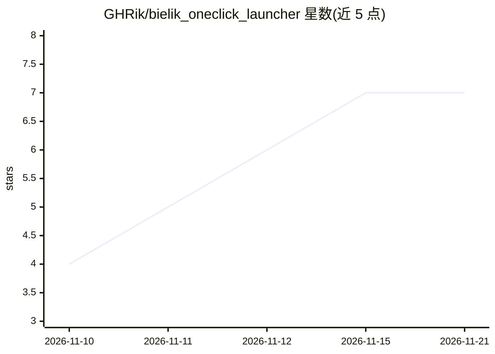

# GHRik/bielik_oneclick_launcher

⭐ 7 · Dart · MIT · 推送 2026-11-16 · [GitHub](https://github.com/GHRik/bielik_oneclick_launcher) · [官网](https://ghrik.github.io/bielik_oneclick_launcher/) · 个人维护

**安卓一键本地运行 Bielik 模型的启动器**

一款 Flutter 构建的 Android 应用，供用户在手机上本地运行 Bielik 语言模型：应用内下载 GGUF 权重（1.5B 约 1.7 GB、4.5B 约 5 GB），离线对话，可调推理参数并查看实时统计。安装途径为 Google Play 封闭测试或直接下载 ARM64 APK；CPU 为默认推理后端，OpenCL GPU 推理已在部分机型上测试。开发需 Flutter 3.47.9 与 Android SDK。模型权重由 SpeakLeash / ACK Cyfronet AGH 提供，启动器本身为 MIT 许可。

## 筛选速览

| 维度 | 判定 | 备注 |
|---|---|---|
| AI 角色 | `ai-native` | 本体是模型或模型工具 |
| 许可风险 | `permissive` | MIT |
| 部署形态 | `None` |  |
| 模型依赖 | local-ok | 支持本地模型 |
| 硬件要求 | — | 无带数字的原话,不猜 |
| 安装摩擦 | `low` | 无编译、无系统依赖或容器化 |
| 成熟度 | — | 结构信号不足 |

## 能力要点

- 应用内下载 GGUF 模型并离线聊天
- 实时推理统计与可配置模型参数
- CPU 默认，OpenCL GPU 后端已在部分机型测试
- 提供 Google Play 封闭测试与 APK 两种安装途径

## 适用场景

- 在手机上离线运行 Bielik 模型对话
- 在无网络环境下使用本地 LLM
- 在 Android 设备上测试不同量化规格的模型

## 场景标签

`聊天机器人` · 领域:对话与助手

## 证据(README 行号)

> L3: Run **Bielik** on your Android phone — download a GGUF in the app, chat offline, tune inference, and watch live stat
> L34: **CPU** is the default. **OpenCL** on GPU has been tested on OnePlus 15 (CPH2747) and Pixel 8 Pro. GPU inference do

## 星数曲线

2026-11-10 4 → 2026-11-21 7（+3）

---
*卡片 v1 · prompt 1.4 · 生成 2026-11-20 · 置信度 high · 依据 README sha `802bb4398a8e` · [字段定义](../../DATASET.md)*
