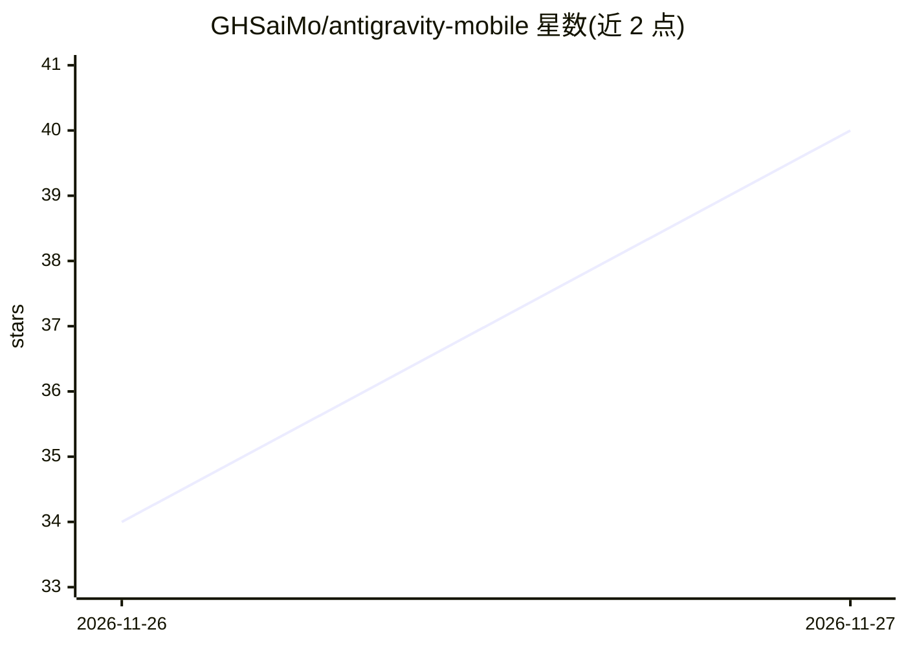

# GHSaiMo/antigravity-mobile

⭐ 40 · Go · MIT · 推送 2026-11-26 · [GitHub](https://github.com/GHSaiMo/antigravity-mobile) · [官网](https://mgy.jiuge.space/) · 个人维护 · 中文 README

**Google Antigravity AI Agent 的开源原生移动伴侣客户端**

为 Google Antigravity AI Agent 提供的原生 iOS/Android 移动端与本地 Go 网关（mgy）：手机可实时对话、审批高危命令、查看多智能体工作流与配额仪表盘，支持灵动岛/锁屏实时活动、APNs/FCM 推送、PWA 访问与扫码配对。网关单二进制安装脚本支持 macOS/Linux/Windows，也可 make 源码编译；全链路零知识 E2EE，MIT 开源，iOS 版上架 App Store 并内置离线演示模式。

## 筛选速览

| 维度 | 判定 | 备注 |
|---|---|---|
| AI 角色 | `ai-ecosystem` | LLM/agent 周边工具 |
| 许可风险 | `permissive` | MIT |
| 部署形态 | `None` |  |
| 模型依赖 | — | README 未给出锁定关系 |
| 硬件要求 | — | 无带数字的原话,不猜 |
| 安装摩擦 | `medium` | 含编译或系统依赖之一 |
| 成熟度 | — | 结构信号不足 |

## 能力要点

- 原生 iOS（SwiftUI）/Android（Compose）/PWA 四端与 mgy Go 网关架构
- 灵动岛/锁屏实时活动审批、APNs 推送与 5h/7d 配额小组件
- 零知识端到端加密（ECDH P-256 + AES-256-GCM）与多地域中继池
- App Store 正式上架并内置零配置离线演示模式

## 适用场景

- 离席时用手机审批 Antigravity 的高危命令与方案
- 在移动端监控多智能体工作流与终端日志
- 查看 5h/每周配额与 Token 消耗仪表盘

## 场景标签

`编码 Agent` · 领域:编码与开发

## 证据(README 行号)

> L5: > **The Full-Stack Mobile & Remote Companion for Google Antigravity AI Agent.**
> L6: > 随时随地，在 iPhone、iPhone Duo、iPad、Android 或手机浏览器上实时对话、审批决策、调度多智能体工作流，并掌握上下文水位与配额消耗。
> L138: 手机端 (iOS / Android / PWA) ──[LAN / Tailscale / Zero-Knowledge E2EE Relay / Cloudflare HTTPS]──▶ mgy Go 网关 ──▶ Anti

## 星数曲线

2026-11-26 34 → 2026-11-27 40（+6）

---
*卡片 v1 · prompt 1.4 · 生成 2026-11-26 · 置信度 high · 依据 README sha `0591144dbf7d` · [字段定义](../../DATASET.md)*
