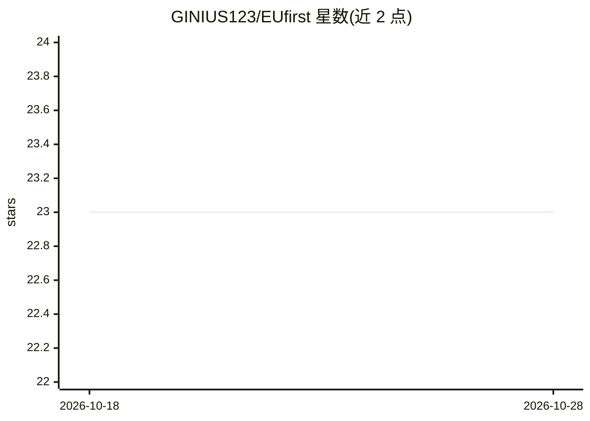

# GINIUS123/EUfirst

⭐ 23 · CC0-1.0 · 推送 2026-03-30 · [GitHub](https://github.com/GINIUS123/EUfirst) · 个人维护

**欧盟主权 AI 工具策展清单：按类别收录经来源核验的 50+ 工具**

社区维护的 awesome 类清单，收录总部位于欧盟、在欧盟托管与治理的 AI 工具、模型与基础设施，当前追踪 50+ 工具、16 个类别，覆盖 LLM、国家级主权模型、云与 GPU 基础设施、向量数据库、MLOps、搜索、通讯、分析及自托管 AI 栈。条目以表格列出国家、功能与标签（OSS/FREE/API/SELF-HOST/GOV），并以美国云依赖、CLOUD Act 与 EU AI Act 执法时间点（2026-08-02）说明清单背景；每个条目标注欧盟来源核验。

## 筛选速览

| 维度 | 判定 | 备注 |
|---|---|---|
| AI 角色 | `ai-knowledge` | 知识聚合/清单类 |
| 许可风险 | `viral` | CC0-1.0 |
| 部署形态 | `None` |  |
| 模型依赖 | — | README 未给出锁定关系 |
| 硬件要求 | — | 无带数字的原话,不猜 |
| 安装摩擦 | `low` | 无编译、无系统依赖或容器化 |
| 成熟度 | — | 结构信号不足 |

## 能力要点

- 50+ 工具按 16 个类别组织，含国家与 OSS/FREE/API/SELF-HOST/GOV 标签
- 收录政府背景的主权国家 LLM（SOOFI/PLLuM/Apertus 等）
- 附 AI Act 相关说明（GPAI 透明度义务、医疗高风险分类）
- 专设自托管 AI 栈章节（Ollama/llama.cpp/vLLM/LocalAI 等）

## 适用场景

- 寻找欧盟本地托管、可自部署的 LLM 与 AI 服务以规避美国司法管辖
- 为合规需求筛选满足 GDPR 与 EU AI Act 要求的工具供应商
- 了解欧洲主权 AI 与政府背景模型的生态版图

## 场景标签

`精选清单` · 领域:学习与行业

## 证据(README 行号)

> L3:  The open-source directory of EU-sovereign AI tools
> L5:  A curated list of AI tools built, hosted, and governed within the EU.
> L10: **Currently tracking: 50+ tools across 16 categories**

## 星数曲线

2026-10-18 23 → 2026-10-28 23（+0）

---
*卡片 v1 · prompt 1.4 · 生成 2026-10-27 · 置信度 high · 依据 README sha `23a77b237dbc` · [字段定义](../../DATASET.md)*
