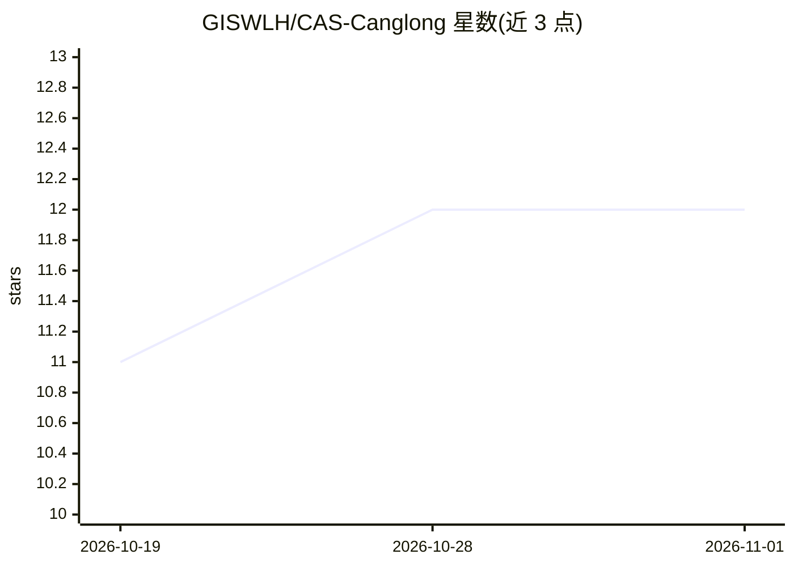

# GISWLH/CAS-Canglong

⭐ 12 · Jupyter Notebook · MIT · 推送 2026-10-27 · [GitHub](https://github.com/GISWLH/CAS-Canglong) · [官网](https://huggingface.co/spaces/LonghaoWang/CAS-Canglong) · 组织维护 · 中文 README

**3-D Earth transformer 预测全球海温与 ENSO，提前 1–16 个月**

面向次季节到季节（S2S）预报的 43.9M 参数海洋–大气耦合 Transformer：从 16 个月 ERA5 场数据（3-D patch 嵌入、窗口自注意力）预测全球月度海温与 Niño 3.4 指数，提前 1–12/16 个月。发布内容含论文代码与 notebook、figshare 权重、Hugging Face 上的 12 个月冻结模型（含 CPU 推理示例）、2016–2022 hindcast 数据集（CC BY 4.0）及 canglong.earth 实时门户。限制：实时 16 个月产品权重未发布；Niño 3.4 校准后技巧弱于未校准版本，作者提示谨慎解读 ENSO 展望。

## 筛选速览

| 维度 | 判定 | 备注 |
|---|---|---|
| AI 角色 | `ai-native` | 本体是模型或模型工具 |
| 许可风险 | `permissive` | MIT |
| 部署形态 | `library` | 以包/库形式分发 |
| 模型依赖 | — | README 未给出锁定关系 |
| 硬件要求 | — | 无带数字的原话,不猜 |
| 安装摩擦 | `medium` | 含编译或系统依赖之一 |
| 成熟度 | — | 结构信号不足 |

## 能力要点

- 43.9M 参数 3-D Earth-specific transformer，RTX 4090 上 0.8 秒完成 721×1440 预报，也可四核 CPU 运行
- 发布 12 个月概率型 SST/ENSO 模型（均值、离散度、分位概率）及 CPU 推理示例
- 权重与训练数据公开于 figshare，独立 PyTorch 复现（WeatherAI）输出一致
- 配套 hindcast 数据集（2016–2022，lead 1–12）与 canglong.earth 实时门户

## 适用场景

- 运行/复现论文的月度 SST 预测并下载公开权重
- 下载最新 12 个月 SST/ENSO 概率预报数据（无需 GPU）
- 用 hindcast 数据集做 S2S 预报技巧评估或归因研究

## 场景标签

`科研工具` · 领域:学习与行业

## 证据(README 行号)

> L16: CAS-Canglong is a 3-D Earth-specific transformer that learns the coupled ocean–atmosphere system from ERA5 and pred
> L83: - **Ocean memory, learned end to end.** Sixteen months of eight ERA5 fields (SST, sea-level pressure, latent heat f
> L86: - **Fast.** The 43.9 M-parameter paper model runs a full 721 × 1440 forecast in 0.8 s on an RTX 4090, or in about a

## 星数曲线

2026-10-19 11 → 2026-11-01 12（+1）

---
*卡片 v1 · prompt 1.4 · 生成 2026-11-01 · 置信度 mid · 依据 README sha `5ec3797e7527` · [字段定义](../../DATASET.md)*
