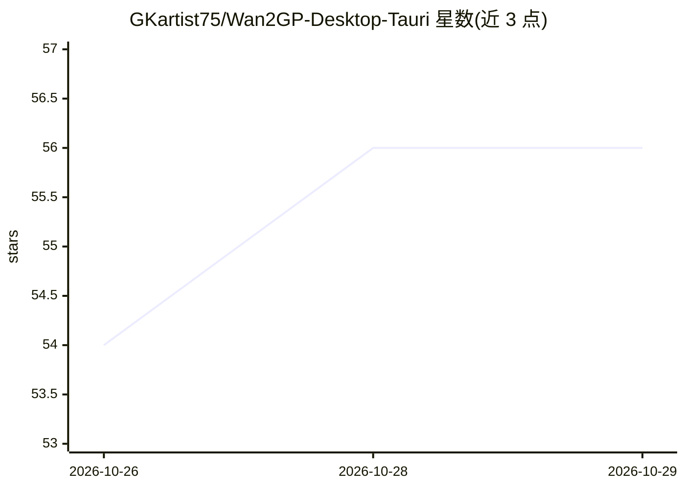

# GKartist75/Wan2GP-Desktop-Tauri

⭐ 56 · Rust · MIT · 推送 2026-10-27 · [GitHub](https://github.com/GKartist75/Wan2GP-Desktop-Tauri) · 个人维护

**给创作者的一键安装 Wan2GP 桌面启动器，免 Python/CUDA 环境搭建**

基于 Tauri 的桌面启动器/安装器，负责安装、配置并运行上游 Wan2GP（deepbeepmeep/WanGP）生成式视频/图像/音频/TTS 应用：自动 clone 仓库、用 uv/venv/conda 建环境、装 PyTorch+CUDA 与 GPU 内核，提供 GPU 检测、Auto-Tune、多 GPU 选择、缓存清理与更新/回滚。面向想在本地 GPU（6GB VRAM 起步）跑 Wan2GP 的用户，免去手工 Python/CUDA 配置。Windows 较成熟；Linux/macOS 为新支持、缺测试者；Intel Mac 不支持。

## 筛选速览

| 维度 | 判定 | 备注 |
|---|---|---|
| AI 角色 | `ai-ecosystem` | LLM/agent 周边工具 |
| 许可风险 | `permissive` | MIT |
| 部署形态 | `desktop` | 安装包/桌面程序 |
| 模型依赖 | — | README 未给出锁定关系 |
| 硬件要求 | `gpu-8g` | |
| 安装摩擦 | `medium` | 含编译或系统依赖之一 |
| 成熟度 | `idea` | |

## 能力要点

- 一键安装：clone→环境→PyTorch+CUDA→内核→配置全自动，前置依赖（Git/uv/Python/Conda）可在面板内就地安装
- 跨平台桌面构建：Windows NSIS/MSI、Linux AppImage/.deb、macOS dmg，附 SHA256 校验
- Auto-Tune 与 GPU 选择：按显存推荐 KV 量化（Auto/INT8/Q4），多 GPU 解析为 --gpu cuda:N
- Desktop/Browser/终端/无 GPU Chrome 多种启动方式，AppImage 支持应用内自更新

## 适用场景

- 不想配 Python/CUDA 环境就在本地 GPU 上跑 Wan2GP 生成视频/图像
- 在低显存（6GB 起）机器上通过 Auto-Tune 量化运行大模型
- 统一管理 Wan2GP 的模型目录、输出目录与磁盘缓存

## 场景标签

`视频生成` `图像生成` `语音合成` · 领域:内容生成

## 证据(README 行号)

> L3: One-click **Wan2GP (WanGP)** — generative video, image, audio and TTS on your own GPU. No Python, no CUDA setup.
> L13: **6 GB VRAM** is enough to start; the big models want 16–24 GB. Wan2GP itself is deepbeepmeep/WanGP — this reposito

## 星数曲线

2026-10-26 54 → 2026-10-29 56（+2）

---
*卡片 v1 · prompt 1.4 · 生成 2026-10-27 · 置信度 mid · 依据 README sha `53dce6081f3d` · [字段定义](../../DATASET.md)*
