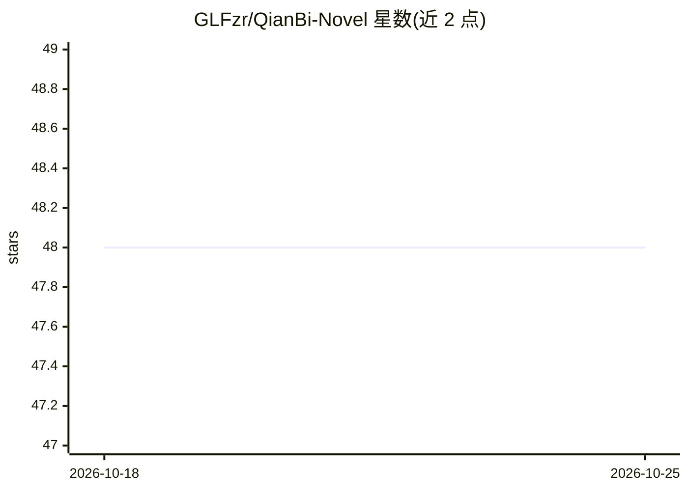

# GLFzr/QianBi-Novel

⭐ 48 · Python · MIT · 推送 2026-09-27 · [GitHub](https://github.com/GLFzr/QianBi-Novel) · [官网](https://github.com/GLFzr/QianBi-Novel/releases/latest) · 个人维护 · 中文 README

**人 AI 共写的长篇网文创作桌面应用，带闸门式写作流水线**

Windows 桌面应用（PySide6 + QML），面向中文网文作者，提供六阶段共写流水线：立项→核心设定→剧情总纲→世界书与正则→单元细纲→正文写作，每阶段可与 Agent 讨论定稿。核心机制包括条目化世界书按预算注入、正则 must 契约注入每张写作 prompt 并做确定性复检、三层审校（本地 L0 预检 + 6 维 LLM 终审 + 引证验真与投票）、剧情反哺回写世界书。BYOK 全本地，书稿不落云端；内置 prompt 按 DeepSeek API 调校，预置 12 家 OpenAI 兼容平台，本地 Ollama/LM Studio 走自定义通道。当前为公测阶段。

## 筛选速览

| 维度 | 判定 | 备注 |
|---|---|---|
| AI 角色 | `ai-native` | 本体是模型或模型工具 |
| 许可风险 | `permissive` | MIT |
| 部署形态 | `desktop` | 安装包/桌面程序 |
| 模型依赖 | local-ok | 支持本地模型 |
| 硬件要求 | — | 无带数字的原话,不猜 |
| 安装摩擦 | `low` | 无编译、无系统依赖或容器化 |
| 成熟度 | `idea` | |

## 能力要点

- 条目化世界书：设定按条目登记、按锚点激活、按预算注入
- 正则 must 契约注入每张写作 prompt + 确定性复检（mustscan.py）拦住锁定
- 三层审校：L0 零成本预检 → 6 维 LLM 终审（引证验真 + 3 票投票）→ 定向修复环
- Agent 操作层：自然语言指令直接操作应用（回退/重写/重生成），破坏性操作先归档留底

## 适用场景

- 与 AI 分阶段共写长篇网文，每步可插手、可回滚
- 写同人文时导入原作设定集并逐条验真，用 must 契约拦住 OOC
- 在本地管理多本书稿、版本历史与导出（txt/epub），Key 不出本机

## 场景标签

`AI 写作` · 领域:内容生成

## 证据(README 行号)

> L10: **人 AI 共写的长篇网文创作台** —— AI 全程透明写作，人永远是作者。
> L36: - 🤝 **共写档六阶段（v0.20 起为默认档）**：立项 → 核心设定 → 剧情总纲 → 世界书与正则 → 单元细纲 → 正文写作，每阶段可与 Agent 讨论后「确定」定稿；全自动档保留为批量补章路径（切换在流水线面板）
> L37: - 🔍 **三层审校**：本地 L0 确定性预检（零成本）→ 6 维 LLM 终审（引证验真 + 3 票投票降噪）→ 反馈环定向修复

## 星数曲线

2026-10-18 48 → 2026-10-25 48（+0）

---
*卡片 v1 · prompt 1.4 · 生成 2026-10-25 · 置信度 mid · 依据 README sha `4ae69728b825` · [字段定义](../../DATASET.md)*
