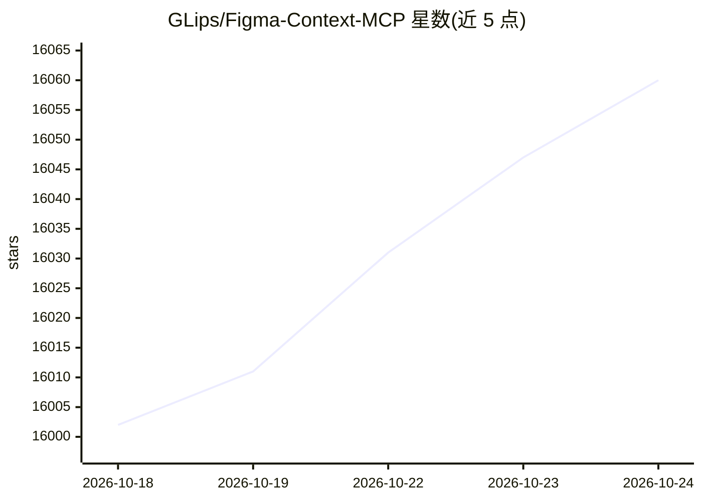

# GLips/Figma-Context-MCP

⭐ 16,062 · TypeScript · MIT · 推送 2026-10-24 · [GitHub](https://github.com/GLips/Figma-Context-MCP) · [官网](https://www.framelink.ai/) · 个人维护

**给 AI 编码工具提供 Figma 布局信息的 MCP 服务器**

一个 Model Context Protocol 服务器，将 Figma 文件的布局与样式元数据提供给 Cursor 等 AI 编码工具。工作流程：在 IDE 聊天中粘贴 Figma 文件/框架/组链接，客户端从 Figma API 获取元数据后，该服务器先对响应做简化与转换，仅保留最相关的布局与样式信息再传给模型，以减少上下文量。使用前需创建 Figma API 访问令牌，通过 MCP 配置文件接入，提供 macOS/Linux 与 Windows 配置示例，也可通过环境变量设置 FIGMA_API_KEY 与 PORT。

## 筛选速览

| 维度 | 判定 | 备注 |
|---|---|---|
| AI 角色 | `ai-ecosystem` | LLM/agent 周边工具 |
| 许可风险 | `permissive` | MIT |
| 部署形态 | `None` |  |
| 模型依赖 | — | README 未给出锁定关系 |
| 硬件要求 | — | 无带数字的原话,不猜 |
| 安装摩擦 | `low` | 无编译、无系统依赖或容器化 |
| 成熟度 | — | 结构信号不足 |

## 动量与使用信号

- 维护:`active` — 距上次 push 2.2 天,年发版 14,30 位贡献者
- 涨星:近 1 天 **+7**(自 20261016 起算)
- 安装:github 包 `release-assets` 月下载无数据
- 平台:WINDOWS / MACOS / LINUX · 协议:MCP

## 能力要点

- 作为 MCP 服务器向 AI 编码客户端提供 Figma 布局与样式信息
- 对 Figma API 响应做简化与翻译，仅传最相关的布局与样式数据
- 支持通过 MCP 配置文件或 FIGMA_API_KEY/PORT 环境变量配置
- 提供 macOS/Linux 与 Windows 两种配置示例

## 适用场景

- 在 Cursor 中根据 Figma 设计稿直接生成界面代码
- 让 AI 编码代理读取设计稿的布局与样式元数据
- 在任意框架中实现 Figma 设计的还原

## 场景标签

 · 领域:开发工具/设计转代码

## 证据(README 行号)

> L23: Give Cursor and other AI-powered coding tools access to your Figma files with this Model Context Protocol server.
> L42: This MCP server is specifically designed for use with Cursor. Before responding with context from the Figma API, it
> L52: > NOTE: You will need to create a Figma access token to use this server. Instructions on how to create a Figma API 

## 星数曲线

2026-10-18 16,002 → 2026-10-24 16,060（+58）

---
*卡片 v1 · prompt 1.4 · 生成 2026-10-18 · 置信度 high · 依据 README sha `a4dc59b864f9` · [字段定义](../../DATASET.md)*
